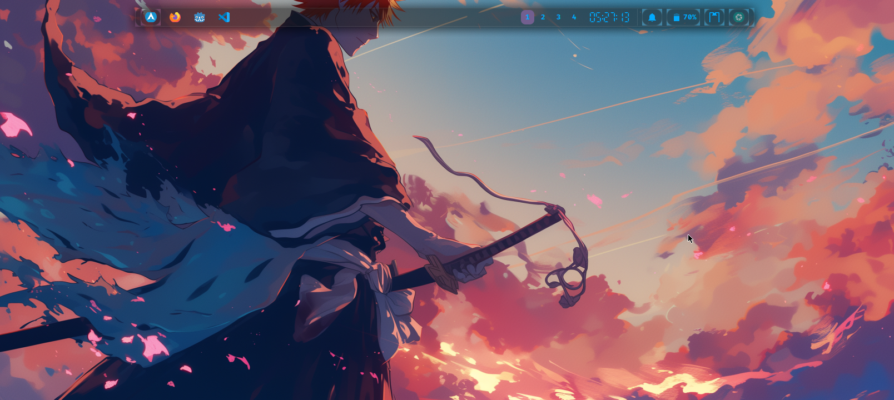
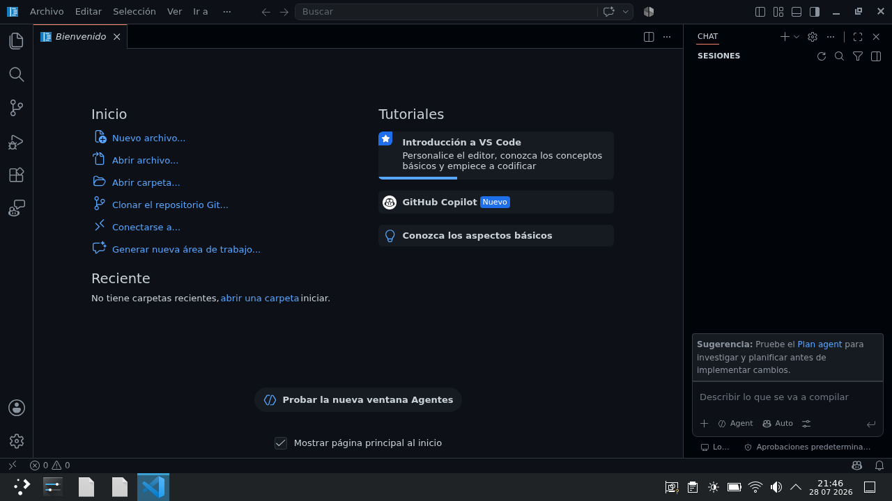
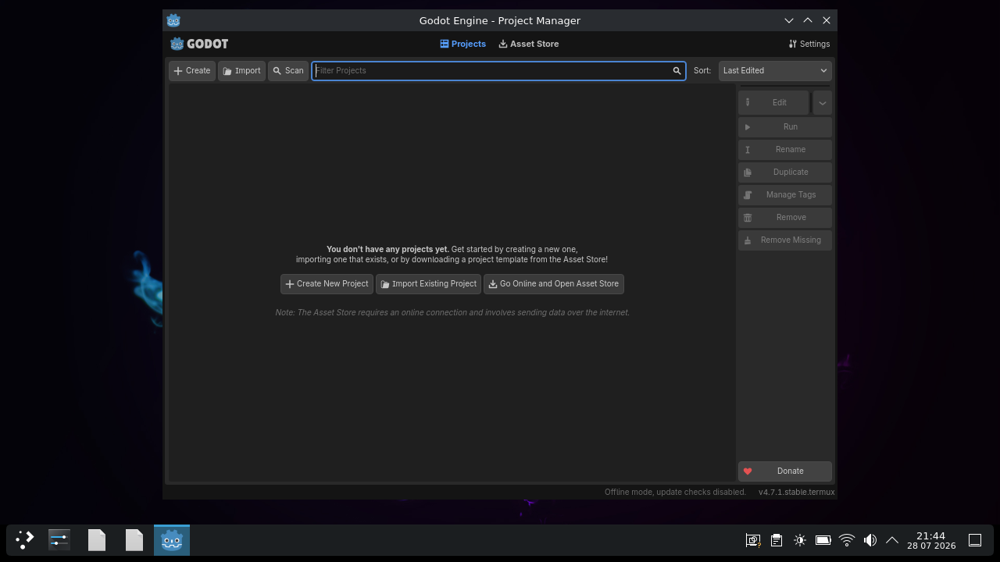
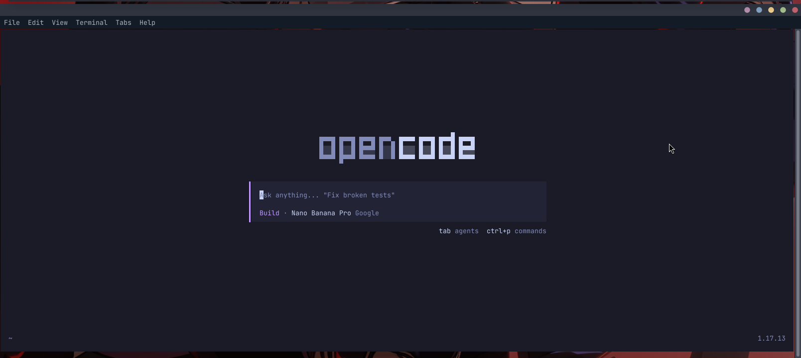
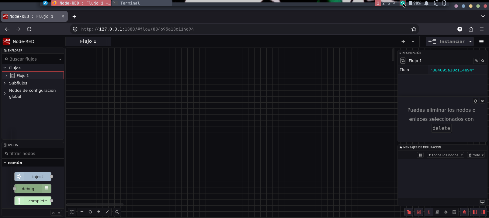
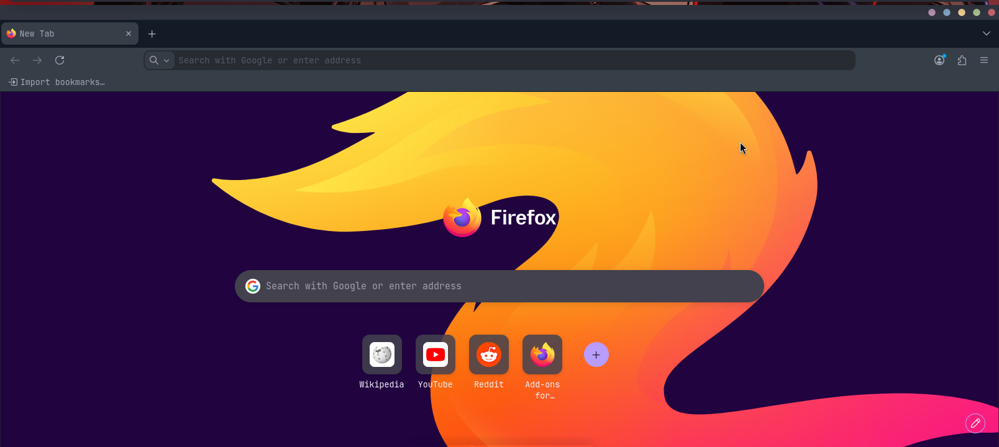

# 📱 Termux-Dev-Station: The Ultimate Native Android Development Station
**A Systemic Flow Project**


<div align="center">

🌐 **Available Languages / Idiomas disponibles:**

[🇪🇸 Español](README.md) | [🇺🇸 English](README_EN.md) | [🇨🇳 中文](README_ZH.md) | [🇧🇷 Português](README_PT.md)

</div>

Welcome! If you've ever wanted to turn your Android device (in Samsung DeX mode, connected to an external monitor, or directly on your phone/tablet) into a real engineering and development workstation without root, heavy emulation layers, or obscure magic scripts, you're in the right place.

This guide shatters the myth that you need to emulate full Linux operating systems (PRoot/Chroot) to write real software on a phone. Here we combine **native execution, lightweight editors, and direct hardware graphics acceleration** to build a 100% stable environment.

This project delivers the best of both worlds: a **step-by-step, transparent explanation** so you understand every change made to your system, paired with **precise commands and automation scripts** ready to unlock your hardware's full potential.

---

## 💡 Project Philosophy and Transparency

We have navigated through outdated tutorials, sluggish emulators, and black-box scripts that install bloated Linux distributions, degrading system memory and battery without explanation. This guide is different: **it runs 100% natively on Termux** with zero blind automations.

There are no intermediate virtualization layers. We leverage Termux's bare-metal environment to extract peak performance:
* **Web and Server Development:** Full-stack runtime with Node.js, Python, and visual automation with Node-RED.
* **Native GameDev with Godot 4:** Build, test, and export Android debug APKs entirely on-device without needing a PC.
* **Offline Documentation with Kiwix & Web Docs:** Instant access to comprehensive technical references (DevDocs, MDN, ArchWiki, Godot Docs) locally without mobile data.
* **Integrated Local AI:** On-device language models powered by Ollama and orchestrated via **Shell-Agent**.
* **Hybrid Graphics Architecture:** Stable CPU-rendered XFCE desktop paired with isolated on-demand GPU acceleration for heavy 3D workloads.

---

## 🖼️ Environment Preview

This is what your workstation looks like once configured and customized with the Systemic Flow environment:

| XFCE Desktop (Modern & Optimized) | Code Editor (Code OSS) |
| :---: | :---: |
|  |  |

| Godot Engine 4 (Android Export) | AI Terminal Assistant (Shell-Agent) |
| :---: | :---: |
|  |  |

| Event Automation (Node-RED) | Web Browsing (Firefox) |
| :---: | :---: |
|  |  |

---

## 📍 Table of Contents

1. [⚡ Hybrid Acceleration Architecture (VirGL + Vulkan + ANGLE)](#-hybrid-acceleration-architecture-virgl--vulkan--angle)
2. [📋 Environment and Display Server Selection](#-environment-and-display-server-selection)
3. [🚀 Preliminary Step: Preparing Termux](#-preliminary-step-preparing-termux)
4. [🛠️ Step-by-Step Installation Guide (Manual)](#️-step-by-step-installation-guide-manual)
   * [Phase 1: Base System Preparation](#phase-1-base-system-preparation)
   * [Phase 2: Repositories, System Utilities, and VirGL Acceleration (Mali GPU)](#phase-2-repositories-system-utilities-and-virgl-acceleration-mali-gpu)
   * [Phase 3: Artificial Intelligence Assistant (Shell-Agent + Ollama)](#phase-3-artificial-intelligence-assistant-shell-agent--ollama)
   * [Phase 4: Node-RED Deployment and Smart Space Cleanup](#phase-4-node-red-deployment-and-smart-space-cleanup)
   * [Phase 5: XFCE Desktop, Display Servers, and Tools Installation](#phase-5-xfce-desktop-display-servers-and-tools-installation)
   * [Phase 6: Phantom Process Killer Fix (Android 12+)](#phase-6-phantom-process-killer-fix-android-12)
   * [Phase 7: VNC Startup Configuration (`xstartup`)](#phase-7-vnc-startup-configuration-xstartup)
   * [Phase 8: Visual Customization, Animations, and Aesthetics (Systemic Flow)](#phase-8-visual-customization-animations-and-aesthetics-systemic-flow)
   * [Phase 9: Enable On-Demand GPU Acceleration in Launchers (Optional)](#phase-9-enable-on-demand-gpu-acceleration-in-launchers-optional)
   * [Phase 10: Godot 4 Suite + Native Android SDK Structure](#phase-10-godot-4-suite--native-android-sdk-structure)
   * [Phase 11: Offline Documentation Center (Kiwix and Web Docs)](#phase-11-offline-documentation-center-kiwix-and-web-docs)
5. [🕹️ System Automation Scripts](#️-system-automation-scripts)
6. [📜 License](#-license)
   
---
   
## ⚡ Hybrid Acceleration Architecture (VirGL + Vulkan + ANGLE)

Unlike most mobile guides restricted strictly to Qualcomm Snapdragon (Adreno/Turnip), this setup enables **real GPU hardware acceleration on ARM Mali GPUs** (MediaTek Dimensity/Helio, Exynos, Unisoc) via a specialized native translation pipeline.

The cornerstone of Systemic Flow's performance is our **on-demand architecture**:
1. We render the base desktop environment via software (CPU llvmpipe) for rock-solid stability, eliminating desktop freezes and black-screen crashes (`BadMatch` errors).
2. We delegate 3D rendering to the GPU in isolation **only** when requested by heavy applications (such as Godot Engine or Firefox).

This approach maintains high framerates where needed while keeping your device cool (~36 °C) under sustained workloads.

---

## 📋 Environment and Display Server Selection

To maximize battery life and multitasking on resource-constrained devices (e.g. 4 GB RAM):

### 1. The Desktop: XFCE4
* **XFCE:** Lightweight, fast, and modular. It serves as our baseline. Paired with our custom panel and Whisker menu configurations, it delivers a sleek modern appearance with a minimal memory footprint.

### 2. Display Server Selection
* **Native X11 (`termux-x11-nightly`):** Directly rendered to the screen via the Termux-X11 Android application (`DISPLAY=:0`). Offers the lowest input latency and seamless touchscreen/stylus integration. Highly recommended.
* **VNC Server (TigerVNC):** Ideal for external monitors or remote desktop access over local Wi-Fi at `127.0.0.1:5901`.

*Both servers are configured for maximum flexibility.*

---

## 🚀 Preliminary Step: Preparing Termux

We strongly recommend installing official Termux builds for **`arm64-v8a`** directly from GitHub Releases rather than third-party app stores to minimize base install size (~30 MB).

---

## 🛠️ Step-by-Step Installation Guide (Manual)

### Phase 1: Base System Preparation
Grant storage permissions, optionally configure repository mirrors, and bring the system up to date:

```bash
termux-setup-storage
termux-change-repo  # (Optional: select faster local mirrors)
apt list --upgradable
apt full-upgrade -y
```

### Phase 2: Repositories, System Utilities, and VirGL Acceleration (Mali GPU)
Add essential community repositories (`tur-repo`, `x11-repo`), development tools, system management utilities (`procps` for `killall`/`pkill`), terminal cosmetics (`figlet`, `neofetch`), the Kiwix server, and the Vulkan/ANGLE translation layer:

```bash
pkg install tur-repo x11-repo android-tools -y
pkg install git unzip wget curl ripgrep procps figlet neofetch kiwix-tools -y
pkg install virglrenderer virglrenderer-android angle-android vulkan-loader-generic openssl -y

# 1. Remove conflicting software rasterizers if present
pkg remove '*icd-swrast' 2>/dev/null

# 2. Install Vulkan Mesa ICD wrapper
wget 'https://github.com/ar37-rs/virgl-angle/releases/download/latest/mesa-vulkan-icd-wrapper_25.0.0-1_aarch64.deb'
dpkg -i mesa-vulkan-icd-wrapper_25.0.0-1_aarch64.deb
rm mesa-vulkan-icd-wrapper_25.0.0-1_aarch64.deb

# 3. Install vgl utility for VirGL server management
wget 'https://github.com/ar37-rs/virgl-angle/raw/refs/heads/main/vgl'
chmod +x vgl && mv vgl $PREFIX/bin/
```

### Phase 3: Artificial Intelligence Assistant (Shell-Agent + Ollama)
We utilize **[shell-agent](https://github.com/adegard/shell-agent)**, an ultralight on-device coding assistant operating entirely in the terminal via Ollama without requiring external cloud APIs:

1. **Automated Setup and Deployment:**
   The installation script clones the repository, deploys Ollama, pulls the recommended model based on available RAM, and registers aliases in `~/.bashrc`:
   ```bash
   git clone https://github.com/adegard/shell-agent.git
   bash shell-agent/setup-termux.sh
   source ~/.bashrc
   ```

2. **Terminal Usage:**
   ```bash
   agent              # Starts interactive chat session
   agent "your prompt" # Runs a single direct task
   ```

3. **Base Variables and GPU Alias in `~/.bashrc`:**
   Ensure your shell startup file includes localization, the on-demand GPU alias, and greetings:
```bash
cat << 'EOF' >> ~/.bashrc
# Localization / Locale
export LANG=es_ES.UTF-8
export LANGUAGE=es_ES.UTF-8
export LC_ALL=C.UTF-8

# On-demand GPU alias for heavy 3D apps (e.g. gpu godot)
alias gpu='env -u LIBGL_ALWAYS_SOFTWARE GALLIUM_DRIVER=virpipe MESA_GL_VERSION_OVERRIDE=4.1COMPAT MESA_GLSL_VERSION_OVERRIDE=410'

clear
echo 'Systemic Flow Dev Station' | figlet 2>/dev/null || echo 'Termux Dev Station'
neofetch 2>/dev/null || true
EOF
source ~/.bashrc
```

### Phase 4: Node-RED Deployment and Smart Space Cleanup
Deploy the lightweight event-driven automation platform (Node-RED) and run storage cleanup routines:

```bash
curl -o termux-nodered-native.sh 'https://raw.githubusercontent.com/Yerensoncasares/termux-dev-station/main/termux-nodered-native.sh'
chmod +x termux-nodered-native.sh
bash termux-nodered-native.sh

# Storage cleanup routine
npm cache clean --force && pip cache purge 2>/dev/null
pkg clean && apt autoremove --purge -y
rm -rf $PREFIX/tmp/*
```

### Phase 5: XFCE Desktop, Display Servers, and Tools Installation
Install XFCE4 desktop packages, display servers (`TigerVNC` and `termux-x11-nightly`), PulseAudio sound server, and native toolchains:

```bash
# Lightweight XFCE desktop environment and core apps
pkg install xfce4 xfce4-goodies thunar htop xfce4-places-plugin picom geany qgit audacity mtpaint -y 

# Display servers and system tools
pkg install tigervnc termux-x11-nightly -y  # High-performance native X11 server

# Audio server
pkg install pulseaudio -y

# Native development applications
pkg install python nodejs code-oss godot firefox -y
```

### Phase 6: Phantom Process Killer Fix (Android 12+)
To prevent Android from terminating background development services when switching applications, execute via Wireless ADB:

```bash
adb pair 192.168.xxx.xxx:xxxxx
adb connect 192.168.xxx.xxx:xxxxx
adb shell "/system/bin/device_config set_sync_disabled_for_tests persistent"
adb shell "/system/bin/device_config put activity_manager max_phantom_processes 2147483647"
adb shell settings put global settings_enable_monitor_phantom_procs false
```

### Phase 7: VNC Startup Configuration (`xstartup`)
For TigerVNC sessions, initialize your configuration file at `~/.vnc/xstartup`:

1. Initialize VNC once to create the directory structure:
   ```bash
   vncserver && vncserver -kill :1
   ```
2. Write `~/.vnc/xstartup`:
```bash
cat << 'EOF' > ~/.vnc/xstartup
#!/data/data/com.termux/files/usr/bin/sh

export localhost="no"

# Force software rendering for baseline desktop stability
export LIBGL_ALWAYS_SOFTWARE=1
export GALLIUM_DRIVER=llvmpipe
export DISPLAY=:1

xset s off &
xset -dpms &

# Localization and runtime paths
export LANG=es_ES.UTF-8
export LANGUAGE=es_ES.UTF-8
export LC_ALL=C.UTF-8
export TMPDIR=/data/data/com.termux/files/usr/tmp
export XDG_RUNTIME_DIR=${TMPDIR}

# Load Xresources and start session
[ -r $HOME/.Xresources ] && xrdb $HOME/.Xresources
dbus-launch --exit-with-session startxfce4
EOF
chmod +x ~/.vnc/xstartup
```

---

### Phase 8: Visual Customization, Animations, and Aesthetics (Systemic Flow)
Equip your desktop with modern typography, Tokyo Night aesthetics, smooth Picom fading animations, and custom application launchers:

#### 1. Base Themes and Terminal Utilities
```bash
# 1. Base utilities and themes
pkg install arc-gtk-theme papirus-icon-theme starship lsd fontconfig-utils -y

# 2. Terminal prompt setup (Starship Tokyo Night preset)
mkdir -p ~/.config
starship preset tokyo-night -o ~/.config/starship.toml
```

#### 2. Deploy Assets v1.0.2 (Themes, Icons, Desktop Configs, and App Suite)
Download the official Systemic Flow v1.0.2 release package, deploy settings (XFCE panels, Picom, GTK themes, and custom application launchers), and purge temporary files:

```bash
# 1. Cleanup and download package v1.0.2
rm -rf ~/.fonts ~/.themes ~/.icons ~/assets.zip.001 ~/assets
curl -L -o ~/assets.zip.001 "https://github.com/Yerensoncasares/termux-dev-station/releases/download/V1.0.2/assets.zip.001"

# 2. Extract package into home directory (creates ~/assets/)
unzip -qo ~/assets.zip.001 -d ~/ && rm ~/assets.zip.001

# 3. Deploy themes, fonts, and base icons
cp -rf ~/assets/.icons ~/assets/.themes ~/assets/.fonts ~/
fc-cache -fv

# 4. Deploy custom application icons
mkdir -p ~/.local/share/icons
cp -rf ~/assets/icons/* ~/.local/share/icons/ 2>/dev/null || true

# 5. Copy preconfigured desktop files (xfce4, gtk-3.0, picom, autostart)
mkdir -p ~/.config
cp -rf ~/assets/config/* ~/.config/

# 6. Install desktop launchers (Blockbench, DevDocs, Kiwix, Python Docs, etc.)
mkdir -p ~/.local/share/applications
cp -rf ~/assets/applications/* ~/.local/share/applications/ 2>/dev/null || true
update-desktop-database ~/.local/share/applications/ 2>/dev/null || true

# 7. Move documentation and server modules (Python UI & Kiwix UI) to $HOME
cp -rf ~/assets/docs/mi_kiwix_ui ~/assets/docs/mi_ui_python ~/

# 8. Clean temporary extraction directory
rm -rf ~/assets

# 9. Disable native XFCE compositor so Picom manages compositing
xfconf-query -c xfwm4 -p /general/use_compositing -s false 2>/dev/null || true

# 10. Bashrc integration
grep -q 'starship init bash' ~/.bashrc || echo 'eval "$(starship init bash)"' >> ~/.bashrc
grep -q 'alias ls="lsd"' ~/.bashrc || echo 'alias ls="lsd"' >> ~/.bashrc
source ~/.bashrc
```

---

### Phase 9: Enable On-Demand GPU Acceleration in Launchers (Optional)
While the desktop runs on software rendering for stability, you can attach GPU acceleration to heavy applications directly in their application entries:

* **Code-OSS (VS Code):** Kept in **software rendering** (`LIBGL_ALWAYS_SOFTWARE=1`) to avoid Electron rendering glitches.
* **Firefox and Godot Engine:** Routed through **on-demand GPU acceleration** (`GALLIUM_DRIVER=virpipe`) for responsive 3D rendering.

To configure them directly via Whisker Menu (Right-click > **Edit Application**):

* **Code-OSS:** `env LIBGL_ALWAYS_SOFTWARE=1 /data/data/com.termux/files/usr/bin/code-oss %F`
* **Firefox:** `env -u LIBGL_ALWAYS_SOFTWARE GALLIUM_DRIVER=virpipe MESA_GL_VERSION_OVERRIDE=4.1COMPAT MESA_GLSL_VERSION_OVERRIDE=410 firefox %u`
* **Godot Engine:** `env -u LIBGL_ALWAYS_SOFTWARE GALLIUM_DRIVER=virpipe MESA_GL_VERSION_OVERRIDE=4.1COMPAT MESA_GLSL_VERSION_OVERRIDE=410 godot %u`

---

### Phase 10: Godot 4 Suite + Native Android SDK Structure

Godot inside Termux does not require downloading Google's monolithic Android Studio SDK (whose precompiled binaries are x86_64-exclusive). Godot only checks for a standardized directory hierarchy and native debugging/signing binaries.

> **Technical Note:** Installing `apksigner` in Termux automatically installs **Java 21 OpenJDK** (`openjdk-21`) as a direct package dependency.

#### 1. Prepare Tools and Symbolic Links
```bash
# 1. Install Android tools (pulls OpenJDK 21 automatically)
pkg install android-tools apksigner -y

# 2. Build folder structure required by Godot
mkdir -p ~/android-sdk/platform-tools
mkdir -p ~/android-sdk/build-tools/36.0.0

# 3. Symlink adb to platform-tools
ln -s $(which adb) ~/android-sdk/platform-tools/adb

# 4. Symlink apksigner to build-tools
ln -s $(which apksigner) ~/android-sdk/build-tools/36.0.0/apksigner
```

#### 2. Configure Paths inside Godot Engine Editor
Launch Godot (`gpu godot`), navigate to **Editor > Editor Settings > Export > Android**, and configure the paths:

* **Java SDK Path:** `/data/data/com.termux/files/usr/lib/jvm/java-21-openjdk`
* **Android SDK Path:** `/data/data/com.termux/files/home/android-sdk`
* **Debug Keystore:** `/data/data/com.termux/files/home/.local/share/godot/keystores/debug.keystore`
* **Debug Keystore User:** `androiddebugkey`
* **Debug Keystore Password:** `android`

---

### Phase 11: Offline Documentation Center (Kiwix and Web Docs)

To ensure zero reliance on internet connectivity and avoid unverified search results, the station bundles two offline documentation collections hosted on the [GitHub Repository Releases](https://github.com/Yerensoncasares/termux-dev-station/releases):

1. **Kiwix Library (`kiwix.zip.*`):** 8-part split archive containing `.zim` files: full **ArchWiki**, Termux Wiki, FreeCodeCamp courses, Bootstrap, and LibreTexts university textbooks (Mathematics & Engineering).
2. **Web Suite and Books (`python.zip.*`):** 3-part split archive containing full offline websites: **MDN Web Docs**, official **Godot Docs**, interactive **learn-gdscript** tutorials, and the **librosgratis.dev** library.

---

#### 📥 1. Direct Terminal Download (Optional)
Download split volumes directly into your Android Downloads folder:

```bash
cd ~/storage/downloads
BASE_URL="https://github.com/Yerensoncasares/termux-dev-station/releases/download/V1.0.2"

# Download 3 parts of Python / Web Docs
for p in 001 002 003; do
  wget -c --show-progress "$BASE_URL/python.zip.$p"
done

# Download 8 parts of Kiwix
for k in 001 002 003 004 005 006 007 008; do
  wget -c --show-progress "$BASE_URL/kiwix.zip.$k"
done
```

---

#### 📦 2. Archive Reassembly and Extraction
Once downloaded, reassemble and extract both archives in a single step with `cat`:

```bash
cd ~/storage/downloads

# 1. Join and extract Kiwix Library (8 parts -> Downloads/kiwix/)
cat kiwix.zip.* > kiwix_temp.zip
unzip -qo kiwix_temp.zip -d ~/storage/downloads/
rm kiwix_temp.zip

# 2. Join and extract Web Suite / Books (3 parts -> Downloads/python/)
cat python.zip.* > python_temp.zip
unzip -qo python_temp.zip -d ~/storage/downloads/
rm python_temp.zip
```

> **Note:** Do not create nested directories manually; the zip files automatically unpack into `kiwix/` and `python/`. You may safely delete `.zip.001`, `.zip.002`, etc., once extracted to save storage.

---

#### 🚀 Accessing Local Documentation
* **From XFCE Desktop:** Launch either documentation hub directly from the Whisker Menu (**Kiwix Docs Offline** or **Web & Godot Docs Offline**). The background service starts automatically and opens Firefox to the correct port.
* **From Terminal:** 
  * For Kiwix: run `Kw` (hosted at `http://localhost:8080`).
  * For Web Suite: run `Py` (hosted at `http://localhost:8081`).

---

## 🕹️ System Automation Scripts

All scripts reside in `$PREFIX/bin/` so they can be invoked from any terminal prompt.

### 1. System Update Script (`up`)
```bash
cat << 'EOF' > $PREFIX/bin/up
#!/data/data/com.termux/files/usr/bin/bash
apt list --upgradable
yes | pkg update && pkg upgrade -y
EOF
chmod +x $PREFIX/bin/up
```

### 2. Native X11 Graphical Startup (`on`)
```bash
cat << 'EOF' > $PREFIX/bin/on
#!/data/data/com.termux/files/usr/bin/bash

termux-wake-lock
am force-stop com.termux.x11 2>/dev/null
pkill -9 -f termux-x11 2>/dev/null
vgl q 2>/dev/null
pkill -9 -f virgl 2>/dev/null
pkill -9 -f picom 2>/dev/null
sleep 1

TMPDIR=/data/data/com.termux/files/usr/tmp
rm -rf "$TMPDIR"/.X11-unix/X* "$TMPDIR"/dbus-* "$TMPDIR"/pulse-* "$HOME"/.cache/sessions/*

# Start graphics server in Vulkan mode
vgl angle=vulkan &
sleep 2

# Start Termux-X11 and Android activity
export DISPLAY=:0
termux-x11 :0 -ac &
sleep 2
am start --user 0 -n com.termux.x11/.MainActivity >/dev/null 2>&1

# Sound server and environment variables
pulseaudio --start --exit-idle-time=-1 2>/dev/null
export LANG=es_ES.UTF-8
export LIBGL_ALWAYS_SOFTWARE=1
export GALLIUM_DRIVER=llvmpipe

[ -r $HOME/.Xresources ] && xrdb $HOME/.Xresources

# Clean XFCE launch (Picom starts automatically via autostart)
dbus-run-session -- startxfce4
EOF
chmod +x $PREFIX/bin/on
```

### 3. VNC Server Startup (`vnc-on`)
```bash
cat << 'EOF' > $PREFIX/bin/vnc-on
#!/data/data/com.termux/files/usr/bin/bash

termux-wake-lock
export TMPDIR=/data/data/com.termux/files/usr/tmp
export DISPLAY=:1

# 1. Clean previous sockets
vncserver -kill :1 >/dev/null 2>&1
rm -rf "$TMPDIR"/.X11-unix/X1 "$TMPDIR"/dbus-* "$TMPDIR"/pulse-* "$HOME"/.vnc/*.pid "$HOME"/.vnc/*.log

# 2. Launch Vulkan graphics server
vgl q 2>/dev/null
pkill -9 -f virgl 2>/dev/null
vgl angle=vulkan &
sleep 2
sync

# 3. Audio
pulseaudio --start --exit-idle-time=-1 2>/dev/null

# 4. Start VNC server
vncserver :1 -geometry 1280x720 -depth 24 -localhost no
echo -e "\n[✓] VNC server started. Connect your viewer to: 127.0.0.1:5901"
renice -n -10 -p $(pgrep -f vncserver) 2>/dev/null
EOF
chmod +x $PREFIX/bin/vnc-on
```

### 4. Kiwix Offline Server Launcher (`Kw`)
```bash
cat << 'EOF' > $PREFIX/bin/Kw
#!/data/data/com.termux/files/usr/bin/bash

LIBRARY_DIR="$HOME/mi_kiwix_ui"
LIBRARY_XML="$LIBRARY_DIR/cursos_library.xml"
ZIM_PATH="$HOME/storage/downloads/kiwix"
PORT=8080

mkdir -p "$LIBRARY_DIR"

# Free port 8080 if already bound
fuser -k $PORT/tcp 2>/dev/null || pkill -f "kiwix-serve" 2>/dev/null

echo "[+] Indexing .zim archives from $ZIM_PATH..."
if ls "$ZIM_PATH"/*.zim 1> /dev/null 2>&1; then
    for zim in "$ZIM_PATH"/*.zim; do
        kiwix-manage "$LIBRARY_XML" add "$zim"
    done
    echo "[✓] Archives indexed successfully."
else
    echo "[!] No .zim files found in $ZIM_PATH."
fi

echo "[+] Starting Kiwix server on http://127.0.0.1:$PORT..."
if [ -f "$LIBRARY_DIR/index.html" ]; then
    kiwix-serve --port=$PORT -c "$LIBRARY_DIR/index.html" --library "$LIBRARY_XML" --daemon
else
    kiwix-serve --port=$PORT --library "$LIBRARY_XML" --daemon
fi

echo "[✓] Kiwix running in background. Open browser at http://localhost:$PORT"
EOF
chmod +x $PREFIX/bin/Kw
```

### 5. Python UI Server Launcher (`Py`)
```bash
cat << 'EOF' > $PREFIX/bin/Py
#!/data/data/com.termux/files/usr/bin/bash
if [ -f "$HOME/mi_ui_python/server.py" ]; then
    echo "[+] Starting local Python server..."
    python3 "$HOME/mi_ui_python/server.py"
else
    echo "[!] Error: File not found: $HOME/mi_ui_python/server.py"
fi
EOF
chmod +x $PREFIX/bin/Py
```

### 6. Clean Shutdown Script (`off`)
```bash
cat << 'EOF' > $PREFIX/bin/off
#!/data/data/com.termux/files/usr/bin/bash

termux-wake-unlock
export TMPDIR=/data/data/com.termux/files/usr/tmp

echo "Shutting down development workstation..."

# 1. Kill XFCE and Compositor
killall -9 xfce4-session startxfce4 xfwm4 xfdesktop xfce4-panel picom 2>/dev/null
pkill -9 -f picom 2>/dev/null

# 2. Stop graphics servers (VNC, X11, and Vulkan)
vncserver -kill :1 >/dev/null 2>&1
pkill -9 Xvnc 2>/dev/null
am force-stop com.termux.x11 2>/dev/null
pkill -9 -f termux-x11 2>/dev/null
vgl q 2>/dev/null
pkill -9 -f virgl 2>/dev/null

# 3. Stop background services and documentation servers
killall -9 dbus-daemon 2>/dev/null
pulseaudio --kill 2>/dev/null
pkill -9 -f "kiwix-serve" 2>/dev/null
pkill -9 -f "mi_ui_python/server.py" 2>/dev/null

# 4. Release network ports
fuser -k 8080/tcp 2>/dev/null
fuser -k 8000/tcp 2>/dev/null

# 5. Clean runtime sockets and cache
rm -rf "$TMPDIR"/.X11-unix/X* "$TMPDIR"/dbus-* "$TMPDIR"/pulse-* 
rm -rf "$HOME"/.vnc/*.pid "$HOME"/.vnc/*.log "$HOME"/.cache/sessions/*

echo "[✓] Workstation cleanly stopped. RAM released."
EOF
chmod +x $PREFIX/bin/off
```

---

## 📜 License
This project is licensed under the **MIT License**. Created by **Systemic Flow**.