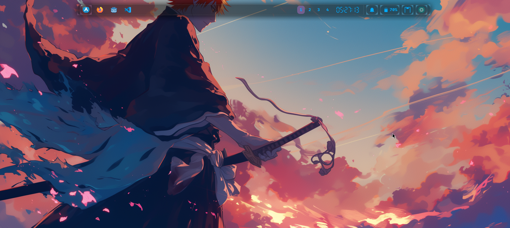
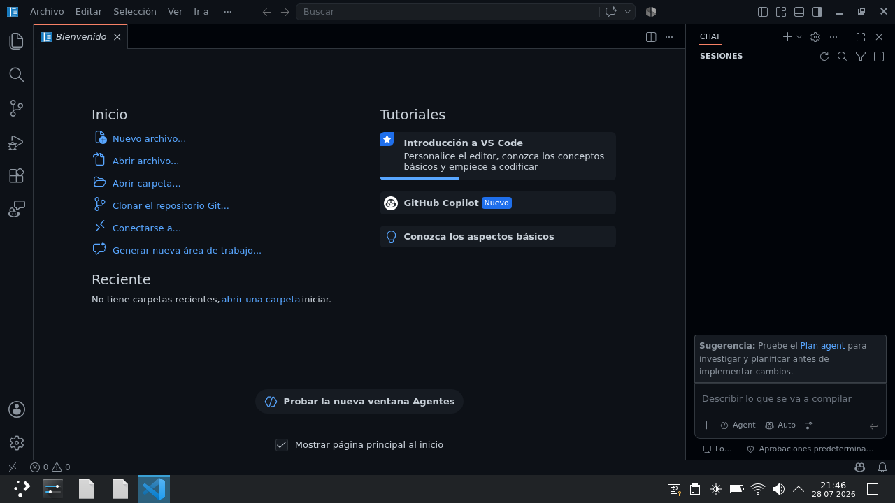
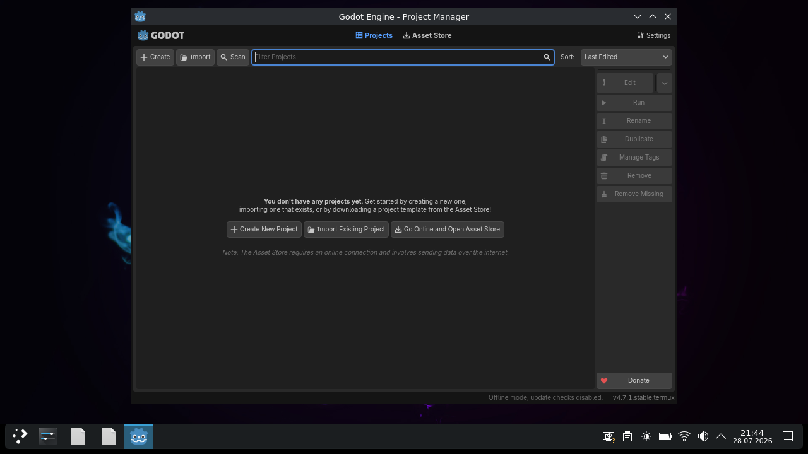
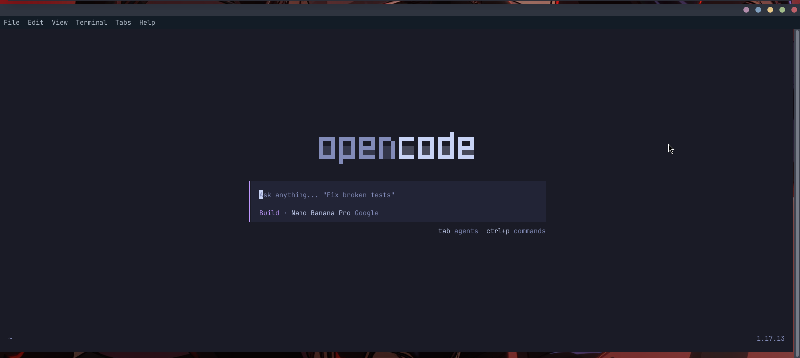
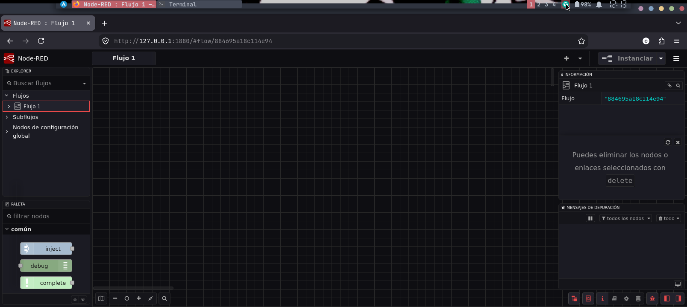
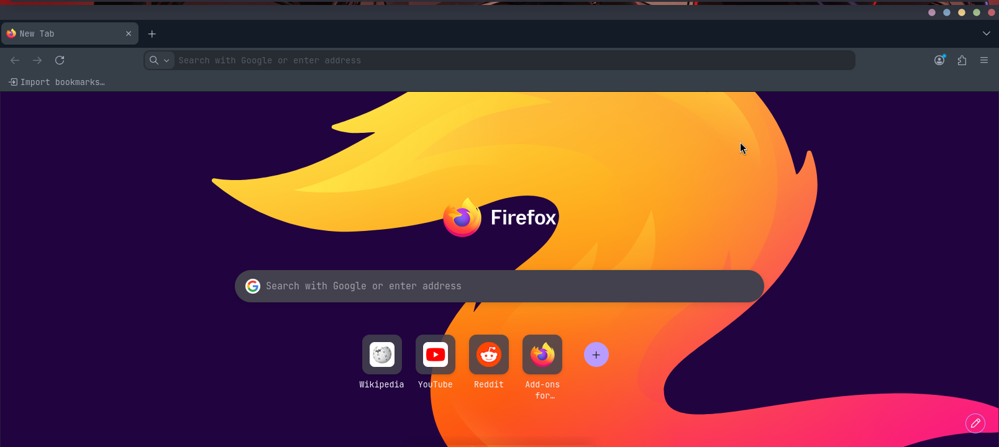

# 📱 Termux-Dev-Station: La Estación de Desarrollo Nativa Definitiva en Android
**Un proyecto de Systemic Flow**


<div align="center">

🌐 **Idiomas disponibles / Available Languages:**

[🇪🇸 Español](README.md) | [🇺🇸 English](README_EN.md) | [🇨🇳 中文](README_ZH.md) | [🇧🇷 Português](README_PT.md)

</div>

¡Bienvenido! Si alguna vez has querido transformar tu dispositivo Android (en modo DeX, conectado a un monitor externo o directamente en tu tablet/móvil) en una auténtica computadora de desarrollo sin necesidad de root, pesadas capas de emulación, ni scripts mágicos y oscuros, estás en el lugar correcto.

Esta guía rompe con el mito de que necesitas instalar sistemas operativos enteros (PRoot/Chroot) para programar de verdad en un teléfono. Aquí combinamos **rendimiento nativo, editores ligeros y aceleración gráfica directa** para construir un entorno 100% estable. 

La guía une lo mejor de dos mundos: **una explicación amigable, accesible y paso a paso** para que cualquier usuario comprenda qué ocurre en su dispositivo, junto con **la precisión técnica exacta**, comandos completos y scripts de automatización listos para exprimir tu hardware al máximo.

---

## 💡 Filosofía del Proyecto y Transparencia

He recorrido el camino de probar guías desactualizadas, emuladores lentos y scripts automáticos que instalan distribuciones de Linux enteras y terminan sobrecargando la memoria y la batería del dispositivo sin que sepas qué pasó. Esta guía es diferente: **es 100% nativa de Termux** y no utiliza automatizaciones a ciegas.

Aquí no hay capas intermedias. Usamos el ecosistema puro de Termux para lograr el rendimiento real del hardware:
* **Desarrollo Web y Servidores:** Entorno completo con Node.js, Python y automatizaciones visuales con Node-RED.
* **Gamedev Nativo con Godot 4:** Creación de proyectos y exportación de paquetes APK de depuración sin salir del teléfono ni requerir un PC.
* **Documentación Offline con Kiwix:** Acceso instantáneo a documentación técnica (DevDocs, MDN, Wikipedia) en local sin consumir datos móviles.
* **Inteligencia Artificial Integrada:** Modelos locales con Ollama orquestados interactivamente por **Shell-Agent**.
* **Aceleración Gráfica Híbrida:** Escritorio XFCE seguro por CPU y GPU bajo demanda para aplicaciones 3D pesadas.

---

## 🖼️ Vista Previa del Entorno

Así es como luce tu estación de trabajo una vez completado el proceso y aplicada la personalización de Systemic Flow:

| Escritorio XFCE (Optimizado y Moderno) | Editor de código (Code OSS) |
| :---: | :---: |
|  |  |

| Godot Engine 4 (Exportación Android) | Asistente de IA con Shell-Agent |
| :---: | :---: |
|  |  |

| Automatización con Node-RED | Navegación Web (Firefox) |
| :---: | :---: |
|  |  |

---

## 📍 Índice de Contenidos

1. [⚡ Arquitectura Híbrida de Aceleración (VirGL + Vulkan + ANGLE)](#-arquitectura-híbrida-de-aceleración-virgl--vulkan--angle)
2. [📋 Entorno y Servidor Gráfico](#-entorno-y-servidor-gráfico)
3. [🚀 Paso Previo: Preparando Termux](#-paso-previo-preparando-termux)
4. [🛠️ Guía de Instalación Paso a Paso (Manual)](#️-guía-de-instalación-paso-a-paso-manual)
   * [Fase 1: Preparación del Sistema Base](#fase-1-preparación-del-sistema-base)
   * [Fase 2: Repositorios, Utilidades del Sistema y Capa de Aceleración Gráfica (VirGL)](#fase-2-repositorios-utilidades-del-sistema-y-capa-de-aceleración-gráfica-virgl)
   * [Fase 3: Asistente de Inteligencia Artificial (Shell-Agent + Ollama)](#fase-3-asistente-de-inteligencia-artificial-shell-agent--ollama)
   * [Fase 4: Despliegue de Node-RED y Limpieza Inteligente de Espacio](#fase-4-despliegue-de-node-red-y-limpieza-inteligente-de-espacio)
   * [Fase 5: Instalación del Escritorio XFCE, Servidores Gráficos y Herramientas](#fase-5-instalación-del-escritorio-xfce-servidores-gráficos-y-herramientas)
   * [Fase 6: Solución al Bloqueo de Procesos Fantasma (Android 12+)](#fase-6-solución-al-bloqueo-de-procesos-fantasma-android-12)
   * [Fase 7: Configuración de Arranque (`xstartup` para VNC)](#fase-7-configuración-de-arranque-xstartup-para-vnc)
   * [Fase 8: Personalización Visual y Estética (Systemic Flow)](#fase-8-personalización-visual-y-estética-systemic-flow)
   * [Fase 9: Habilitar Aceleración GPU en Lanzadores (Opcional)](#fase-9-habilitar-aceleración-gpu-en-lanzadores-opcional)
   * [Fase 10: Suite Godot 4 + Estructura Android SDK Nativa](#fase-10-suite-godot-4--estructura-android-sdk-nativa)
   * [Fase 11: Centro de Documentación Offline (Kiwix)](#fase-11-centro-de-documentación-offline-kiwix)
5. [🕹️ Scripts de Automatización del Sistema](#️-scripts-de-automatización-del-sistema)
6. [📜 Licencia](#-licencia)
   
---
   
## ⚡ Arquitectura Híbrida de Aceleración (VirGL + Vulkan + ANGLE)

A diferencia de la mayoría de guías limitadas a procesadores Snapdragon (Adreno), esta configuración habilita la **aceleración gráfica por GPU real en procesadores con GPU Mali** (MediaTek Dimensity/Helio, Exynos, etc.) mediante una cadena de traducción nativa. 

El verdadero secreto del rendimiento de Systemic Flow radica en nuestra **arquitectura bajo demanda**:
1. Renderizamos el entorno de escritorio por software (CPU) para garantizar una estabilidad absoluta, eliminando de raíz las pantallas negras y los cuelgues (errores `BadMatch`).
2. Delegamos el procesamiento 3D a la GPU de forma aislada **solo** para las aplicaciones que lo exigen (como Godot Engine o Firefox).

Con este método, el rendimiento se dispara, la fluidez es total y tu dispositivo se mantiene fresco (~36 °C) incluso bajo tareas pesadas.

---

## 📋 Entorno y Servidor Gráfico

Para asegurar que tu dispositivo rinda al máximo sin devorar la memoria RAM, hemos optimizado las opciones:

### 1. El Escritorio: XFCE4
* **XFCE:** Ligero, sumamente rápido y minimalista. Es el estándar de esta guía. Más adelante te mostraremos cómo personalizarlo con paneles y menús para que luzca tan moderno y profesional como entornos más pesados, pero consumiendo una fracción de los recursos.

### 2. Elección del Servidor Gráfico (Display Server)
* **X11 Nativo (`termux-x11-nightly`):** Renderizado directo en la pantalla del dispositivo mediante su app dedicada (`DISPLAY=:0`), ofreciendo la menor latencia posible y la mejor integración táctil. Es la opción principal recomendada.
* **Servidor VNC (TigerVNC):** Clásico y universal. Lo mantenemos como una excelente alternativa para aquellos usuarios que necesitan trabajar en pantallas grandes y no cuentan con un proyector, puerto HDMI o modo DeX. Te permite conectarte a `127.0.0.1:5901` desde cualquier visor VNC en un monitor externo vía red local. 

*¡Instalaremos ambas opciones para que tengas total flexibilidad!*

---

## 🚀 Paso Previo: Preparando Termux

Para evitar incompatibilidades con paquetes universales pesados, te recomendamos descargar el APK de Termux adecuado para tu arquitectura (preferiblemente **`arm64-v8a`** desde los Releases oficiales de GitHub en lugar de F-Droid, reduciendo el tamaño base a ~30 MB).

---

## 🛠️ Guía de Instalación Paso a Paso (Manual)

### Fase 1: Preparación del Sistema Base
Otorgamos permisos de almacenamiento, actualizamos espejos (opcional si deseas cambiar de servidor) y ponemos al día los paquetes del sistema:

```bash
termux-setup-storage
termux-change-repo  # (Opcional: ejecuta esto si deseas cambiar los espejos de repositorios)
apt list --upgradable
apt full-upgrade -y
```

### Fase 2: Repositorios, Utilidades del Sistema y Capa de Aceleración Gráfica (VirGL)
Añadimos los repositorios comunitarios esenciales (`tur-repo`, `x11-repo`), herramientas de red, utilidades del sistema imprescindibles para gestión de procesos (`procps` para `killall` y `pkill`), decoraciones de terminal (`figlet`, `neofetch`), servidor Kiwix (`kiwix-tools`) y preparamos la capa de aceleración gráfica avanzada para procesadores Mali mediante ANGLE y Vulkan:

```bash
pkg install tur-repo x11-repo -y
pkg install git unzip wget curl ripgrep procps figlet neofetch kiwix-tools -y
pkg install virglrenderer virglrenderer-android angle-android vulkan-loader-generic openssl -y

# 1. Eliminar renderizadores por software conflictivos si existieran
pkg remove '*icd-swrast' 2>/dev/null

# 2. Instalar el wrapper de Vulkan para Mesa
wget 'https://github.com/ar37-rs/virgl-angle/releases/download/latest/mesa-vulkan-icd-wrapper_25.0.0-1_aarch64.deb'
dpkg -i mesa-vulkan-icd-wrapper_25.0.0-1_aarch64.deb
rm mesa-vulkan-icd-wrapper_25.0.0-1_aarch64.deb

# 3. Instalar herramienta vgl para gestionar el arranque del servidor gráfico
wget 'https://github.com/ar37-rs/virgl-angle/raw/refs/heads/main/vgl'
chmod +x vgl && mv vgl $PREFIX/bin/
```

### Fase 3: Asistente de Inteligencia Artificial (Shell-Agent + Ollama)
Utilizamos **[shell-agent](https://github.com/adegard/shell-agent)**, un asistente local ultraligero que opera directamente en la terminal mediante Ollama sin requerir APIs externas ni conexión a internet tras su configuración inicial:

1. **Despliegue y Configuración Automatizada:**
   El script oficial clona el repositorio, instala Ollama, descarga el modelo de código recomendado e inyecta las variables de entorno y alias en `~/.bashrc`:
   ```bash
   git clone https://github.com/adegard/shell-agent.git
   bash shell-agent/setup-termux.sh
   source ~/.bashrc
   ```

2. **Uso en Terminal:**
   ```bash
   agent              # Inicia la sesión interactiva del asistente
   agent "tu prompt"  # Ejecución de una sola tarea directa
   ```

3. **Variables Base y GPU en `~/.bashrc`:**
   Asegúrate de mantener tu alias para aceleración por GPU y bienvenida en `~/.bashrc`:
   ```bash
cat << 'EOF' >> ~/.bashrc
# Configuración de Idioma / Localización
export LANG=es_ES.UTF-8
export LANGUAGE=es_ES.UTF-8
export LC_ALL=C.UTF-8

# Alias para habilitar GPU bajo demanda en apps 3D (ej: gpu godot)
alias gpu='env -u LIBGL_ALWAYS_SOFTWARE GALLIUM_DRIVER=virpipe MESA_GL_VERSION_OVERRIDE=4.1COMPAT MESA_GLSL_VERSION_OVERRIDE=410'

clear
echo 'Systemic Flow Dev Station' | figlet 2>/dev/null || echo 'Termux Dev Station'
neofetch 2>/dev/null || true
EOF
source ~/.bashrc
   ```

### Fase 4: Despliegue de Node-RED y Limpieza Inteligente de Espacio
Instalamos la plataforma de automatización liviana basada en eventos (Node-RED) y realizamos una rutina de limpieza profunda para liberar espacio:

```bash
curl -o termux-nodered-native.sh 'https://raw.githubusercontent.com/Yerensoncasares/termux-dev-station/main/termux-nodered-native.sh'
chmod +x termux-nodered-native.sh
bash termux-nodered-native.sh

# Rutina de limpieza de almacenamiento
npm cache clean --force && pip cache purge 2>/dev/null
pkg clean && apt autoremove --purge -y
rm -rf $PREFIX/tmp/*
```

### Fase 5: Instalación del Escritorio XFCE, Servidores Gráficos y Herramientas
Instalamos el entorno gráfico XFCE4 junto a sus complementos esenciales, los servidores de visualización (`TigerVNC` y el paquete nativo `termux-x11-nightly`), además del sistema de audio y las herramientas de desarrollo nativas:

```bash
# Entorno XFCE ultraligero y aplicaciones básicas
pkg install xfce4 xfce4-goodies thunar htop xfce4-places-plugin picom geany qgit audacity mtpaint -y 

# Servidores gráficos y herramientas de sistema
pkg install tigervnc termux-x11-nightly -y  # Servidor X11 nativo de alta fluidez

# Audio y configuración post-instalación
pkg install pulseaudio -y

# Aplicaciones de desarrollo nativas
pkg install python nodejs code-oss godot firefox -y
```

### Fase 6: Solución al Bloqueo de Procesos Fantasma (Android 12+)
Para evitar que Android mate tus procesos en segundo plano al cambiar de app, utiliza ADB Inalámbrico desde Opciones de Desarrollador:

```bash
adb pair 192.168.xxx.xxx:xxxxx
adb connect 192.168.xxx.xxx:xxxxx
adb shell "/system/bin/device_config set_sync_disabled_for_tests persistent"
adb shell "/system/bin/device_config put activity_manager max_phantom_processes 2147483647"
adb shell settings put global settings_enable_monitor_phantom_procs false
```

### Fase 7: Configuración de Arranque (`xstartup` para VNC)
Si decides usar VNC, configura tu archivo de inicio `~/.vnc/xstartup`:

1. Inicializa el servidor VNC para generar la estructura:
   ```bash
   vncserver && vncserver -kill :1
   ```
2. Edita `~/.vnc/xstartup`:
```bash
cat << 'EOF' > ~/.vnc/xstartup
#!/data/data/com.termux/files/usr/bin/sh

export localhost="no"

# Forzar renderizado por software y establecer variables de entorno (sincronizado con vnc-on)
export LIBGL_ALWAYS_SOFTWARE=1
export GALLIUM_DRIVER=llvmpipe
export DISPLAY=:1

xset s off &
xset -dpms &

# Localización y variables temporales
export LANG=es_ES.UTF-8
export LANGUAGE=es_ES.UTF-8
export LC_ALL=C.UTF-8
export TMPDIR=/data/data/com.termux/files/usr/tmp
export XDG_RUNTIME_DIR=${TMPDIR}

# Cargar recursos y lanzar sesión XFCE
[ -r $HOME/.Xresources ] && xrdb $HOME/.Xresources
dbus-launch --exit-with-session startxfce4
EOF
chmod +x ~/.vnc/xstartup
```

---

### Fase 8: Personalización Visual, Animaciones y Estética (Systemic Flow)
Para que el entorno cuente con una interfaz moderna, fuentes nítidas, animaciones suaves y sombras sin penalizar la memoria RAM:

#### 1. Instalación de Temas, Fuentes y Línea de Comandos
```bash
# 1. Temas base y utilidades
pkg install arc-gtk-theme papirus-icon-theme starship lsd fontconfig-utils -y

# 2. Configuración de terminal (Starship preset Tokyo Night)
mkdir -p ~/.config
starship preset tokyo-night -o ~/.config/starship.toml

# 3. Paquete visual Systemic Flow (Iconos, Temas y Fuentes)
rm -rf ~/.fonts ~/.themes ~/.icons ~/assets.zip
curl -L -o ~/assets.zip "https://github.com/Yerensoncasares/termux-dev-station/releases/download/V1.0/assets.zip"
unzip -o ~/assets.zip -d ~/ && rm ~/assets.zip

cp -r ~/assets/.icons ~/assets/.themes ~/assets/.fonts ~/
fc-cache -fv
cd assets/ && update-desktop-database $PREFIX/share/applications/ 2>/dev/null || true

# 4. Integración en ~/.bashrc
grep -q 'starship init bash' ~/.bashrc || echo 'eval "$(starship init bash)"' >> ~/.bashrc
grep -q 'alias ls="lsd"' ~/.bashrc || echo 'alias ls="lsd"' >> ~/.bashrc
source ~/.bashrc
```

#### 2. Animaciones y Transiciones Fluidas (Picom)
Configuramos Picom con curvas de desvanecimiento (*fading*) optimizadas para pantallas móviles (60-120 Hz), desactivando el compositor nativo de XFCE para evitar conflictos:

```bash
# 1. Desactivar compositor nativo de XFCE
xfconf-query -c xfwm4 -p /general/use_compositing -s false 2>/dev/null || true

# 2. Configurar perfil de animaciones y sombras
mkdir -p ~/.config/picom
cat << 'EOF' > ~/.config/picom/picom.conf
backend = "xrender";
vsync = false;
use-damage = true;

# Animaciones de apertura/cierre suaves
fading = true;
fade-in-step = 0.05;
fade-out-step = 0.05;
fade-delta = 8;
no-fading-openclose = false;

# Sombras suaves Tokyo Night
shadow = true;
shadow-radius = 12;
shadow-opacity = 0.45;
shadow-offset-x = -10;
shadow-offset-y = -10;
shadow-exclude = [
  "name = 'Notification'",
  "class_g = 'Conky'",
  "class_g ?= 'Notify-osd'",
  "_GTK_FRAME_EXTENTS@:c"
];

inactive-opacity = 0.96;
active-opacity = 1.0;
frame-opacity = 1.0;

wintypes:
{
  tooltip = { fade = true; shadow = true; opacity = 0.95; focus = true; };
  dock = { shadow = false; clip-shadow-above = true; };
  dnd = { shadow = false; };
  popup_menu = { opacity = 0.96; fade = true; shadow = true; };
  dropdown_menu = { opacity = 0.96; fade = true; shadow = true; };
};
EOF

# 3. Configurar inicio automático al abrir XFCE
mkdir -p ~/.config/autostart
cat << 'EOF' > ~/.config/autostart/picom.desktop
[Desktop Entry]
Type=Application
Name=Picom Compositor
Comment=Animaciones y sombras fluidas
Exec=picom -b --config /data/data/com.termux/files/home/.config/picom/picom.conf
Hidden=false
NoDisplay=false
X-GNOME-Autostart-enabled=true
EOF
chmod +x ~/.config/autostart/picom.desktop
```

---

### Fase 9: Habilitar Aceleración GPU en Lanzadores (Opcional)
Nuestra arquitectura renderiza la interfaz por software por defecto para máxima estabilidad, pero puedes habilitar la GPU bajo demanda para aplicaciones pesadas sin necesidad de usar la terminal.

**Importante:** El renderizado está diferenciado por aplicación:

* **Code-OSS (VS Code):** Renderizado **por software** (`LIBGL_ALWAYS_SOFTWARE=1`) para evitar *glitches* de Electron. No se recomienda usar aceleración GPU con Code-OSS.
* **Firefox y Godot Engine:** Utilizan la **GPU bajo demanda** (`GALLIUM_DRIVER=virpipe`) cuando se requiere procesamiento 3D.

Para abrirlos directamente desde el Menú Whisker o el Panel inferior:

1. Haz clic derecho sobre la aplicación en el Menú Whisker o en el Panel y selecciona **Editar aplicación** (o *Propiedades*).
2. En la casilla **Comando**, usa el prefijo apropiado:

* **Code-OSS:** `env LIBGL_ALWAYS_SOFTWARE=1 /data/data/com.termux/files/usr/bin/code-oss %F`
* **Firefox:** `env -u LIBGL_ALWAYS_SOFTWARE GALLIUM_DRIVER=virpipe MESA_GL_VERSION_OVERRIDE=4.1COMPAT MESA_GLSL_VERSION_OVERRIDE=410 firefox %u`
* **Godot Engine:** `env -u LIBGL_ALWAYS_SOFTWARE GALLIUM_DRIVER=virpipe MESA_GL_VERSION_OVERRIDE=4.1COMPAT MESA_GLSL_VERSION_OVERRIDE=410 godot %u`

---

### Fase 10: Suite Godot 4 + Estructura Android SDK Nativa

Godot en Termux no requiere descargar el SDK completo oficial de Google (cuyos binarios precompilados están pensados para Linux x86_64 y fallan en Android). Únicamente valida una estructura de directorios estándar y las utilidades nativas de depuración y firma.

> **Nota Técnica:** Al instalar `apksigner`, el gestor de paquetes de Termux resuelve e instala automáticamente **Java 21 OpenJDK** (`openjdk-21`) como dependencia directa, dejando todo listo en un solo paso.

#### 1. Preparar Herramientas y Enlaces Simbólicos
```bash
# 1. Instalar herramientas de Android (incluye automáticamente Java 21)
pkg install android-tools apksigner -y

# 2. Crear carpetas requeridas por la interfaz de Godot
mkdir -p ~/android-sdk/platform-tools
mkdir -p ~/android-sdk/build-tools/34.0.0
mkdir -p ~/.local/share/godot/keystores

# 3. Enlazar adb a la carpeta platform-tools
ln -s $(which adb) ~/android-sdk/platform-tools/adb

# 4. Enlazar apksigner a la carpeta build-tools
ln -s $(which apksigner) ~/android-sdk/build-tools/34.0.0/apksigner

# 5. Generar Debug Keystore
if [ ! -f ~/.local/share/godot/keystores/debug.keystore ]; then
    keytool -genkey -v -keystore ~/.local/share/godot/keystores/debug.keystore \
      -storepass android -alias androiddebugkey -keypass android -keyalg RSA \
      -keysize 2048 -validity 10000 -dname "CN=Android Debug,O=Android,C=US"
    echo "[✓] Keystore generado correctamente."
fi
```

#### 2. Configurar Rutas en el Editor de Godot
Abre Godot (`gpu godot`), ve a **Editor > Configuración del Editor > Exportar > Android** e ingresa las rutas exactas:

* **Java SDK Path:** `/data/data/com.termux/files/usr/lib/jvm/java-21-openjdk`
* **Android SDK Path:** `/data/data/com.termux/files/home/android-sdk`
* **Debug Keystore:** `/data/data/com.termux/files/home/.local/share/godot/keystores/debug.keystore`
* **Usuario Debug Keystore:** `androiddebugkey`
* **Contraseña Debug Keystore:** `android`

---

### Fase 11: Centro de Documentación Offline (Kiwix)

Permite consultar documentación técnica completa (Python, JavaScript, Godot, Linux o Wikipedia) sin consumir datos ni depender de conexión a internet.

1. Guarda tus archivos `.zim` en tu carpeta interna de Android en `Descargas/kiwix/` (ej: desde [library.kiwix.org](https://library.kiwix.org/)).
2. El script `Kw` indexará automáticamente las bibliotecas y levantará el servidor local en segundo plano.

---

## 🕹️ Scripts de Automatización del Sistema

Todos los scripts residen en `$PREFIX/bin/` para ser invocados directamente desde cualquier terminal.

### 1. Script de Actualización del Sistema (`up`)
```bash
cat << 'EOF' > $PREFIX/bin/up
#!/data/data/com.termux/files/usr/bin/bash
apt list --upgradable
yes | pkg update && pkg upgrade -y
EOF
chmod +x $PREFIX/bin/up
```

### 2. Script de Encendido Gráfico X11 Nativo (`on`)
```bash
cat << 'EOF' > $PREFIX/bin/on
#!/data/data/com.termux/files/usr/bin/bash

termux-wake-lock
am force-stop com.termux.x11 2>/dev/null
pkill -9 -f termux-x11 2>/dev/null
vgl q 2>/dev/null
pkill -9 -f virgl 2>/dev/null
pkill -9 -f picom 2>/dev/null
sleep 1

TMPDIR=/data/data/com.termux/files/usr/tmp
rm -rf "$TMPDIR"/.X11-unix/X* "$TMPDIR"/dbus-* "$TMPDIR"/pulse-* "$HOME"/.cache/sessions/*

# Levantar servidor gráfico en modo Vulkan
vgl angle=vulkan &
sleep 2

# Iniciar X11 y la app de Android
export DISPLAY=:0
termux-x11 :0 -ac &
sleep 2
am start --user 0 -n com.termux.x11/.MainActivity >/dev/null 2>&1

# Configuración de audio y entorno seguro
pulseaudio --start --exit-idle-time=-1 2>/dev/null
export LANG=es_ES.UTF-8
export LIBGL_ALWAYS_SOFTWARE=1
export GALLIUM_DRIVER=llvmpipe

[ -r $HOME/.Xresources ] && xrdb $HOME/.Xresources

# Arranque limpio y nativo de XFCE (Picom se levantará vía autostart)
dbus-run-session -- startxfce4
EOF
chmod +x $PREFIX/bin/on
```

### 3. Script de Encendido VNC (`vnc-on`)
```bash
cat << 'EOF' > $PREFIX/bin/vnc-on
#!/data/data/com.termux/files/usr/bin/bash

termux-wake-lock
export TMPDIR=/data/data/com.termux/files/usr/tmp
export DISPLAY=:1

# 1. Limpieza extrema previa
vncserver -kill :1 >/dev/null 2>&1
rm -rf "$TMPDIR"/.X11-unix/X1 "$TMPDIR"/dbus-* "$TMPDIR"/pulse-* "$HOME"/.vnc/*.pid "$HOME"/.vnc/*.log

# 2. Levantar servidor gráfico en modo Vulkan
vgl q 2>/dev/null
pkill -9 -f virgl 2>/dev/null
vgl angle=vulkan &
sleep 2
sync

# 3. Audio
pulseaudio --start --exit-idle-time=-1 2>/dev/null

# 4. Iniciar VNC con sincronización garantizada
vncserver :1 -geometry 1280x720 -depth 24 -localhost no
echo -e "\n[✓] Servidor VNC iniciado. Conéctate con tu visor en: 127.0.0.1:5901"
renice -n -10 -p $(pgrep -f vncserver) 2>/dev/null
EOF
chmod +x $PREFIX/bin/vnc-on
```

### 4. Servidor de Documentación Offline (`Kw`)
```bash
cat << 'EOF' > $PREFIX/bin/Kw
#!/data/data/com.termux/files/usr/bin/bash

LIBRARY_DIR="$HOME/mi_kiwix_ui"
LIBRARY_XML="$LIBRARY_DIR/cursos_library.xml"
ZIM_PATH="$HOME/storage/downloads/kiwix"
PORT=8080

mkdir -p "$LIBRARY_DIR"

# Liberar puerto 8080 si estaba ocupado
fuser -k $PORT/tcp 2>/dev/null || pkill -f "kiwix-serve" 2>/dev/null

echo "[+] Indexando archivos .zim desde $ZIM_PATH..."
if ls "$ZIM_PATH"/*.zim 1> /dev/null 2>&1; then
    for zim in "$ZIM_PATH"/*.zim; do
        kiwix-manage "$LIBRARY_XML" add "$zim"
    done
    echo "[✓] Documentos indexados correctamente."
else
    echo "[!] No se encontraron archivos .zim en $ZIM_PATH."
fi

echo "[+] Levantando servidor Kiwix en http://127.0.0.1:$PORT..."
if [ -f "$LIBRARY_DIR/index.html" ]; then
    kiwix-serve --port=$PORT -c "$LIBRARY_DIR/index.html" --library "$LIBRARY_XML" --daemon
else
    kiwix-serve --port=$PORT --library "$LIBRARY_XML" --daemon
fi

echo "[✓] Kiwix ejecutándose en segundo plano. Abre tu navegador en http://localhost:$PORT"
EOF
chmod +x $PREFIX/bin/Kw
```

### 5. Lanzador Servidor UI Python (`Py`)
```bash
cat << 'EOF' > $PREFIX/bin/Py
#!/data/data/com.termux/files/usr/bin/bash
if [ -f "$HOME/mi_ui_python/server.py" ]; then
    echo "[+] Iniciando servidor local Python..."
    python3 "$HOME/mi_ui_python/server.py"
else
    echo "[!] Error: No se encontró el archivo $HOME/mi_ui_python/server.py"
fi
EOF
chmod +x $PREFIX/bin/Py
```

### 6. Script de Apagado Limpio (`off`)
```bash
cat << 'EOF' > $PREFIX/bin/off
#!/data/data/com.termux/files/usr/bin/bash

termux-wake-unlock
export TMPDIR=/data/data/com.termux/files/usr/tmp

echo "Apagando estación de desarrollo..."

# 1. Matar entorno XFCE y Compositor
killall -9 xfce4-session startxfce4 xfwm4 xfdesktop xfce4-panel picom 2>/dev/null
pkill -9 -f picom 2>/dev/null

# 2. Detener Servidores Gráficos (VNC, X11 y Vulkan)
vncserver -kill :1 >/dev/null 2>&1
pkill -9 Xvnc 2>/dev/null
am force-stop com.termux.x11 2>/dev/null
pkill -9 -f termux-x11 2>/dev/null
vgl q 2>/dev/null
pkill -9 -f virgl 2>/dev/null

# 3. Detener demonios de soporte
killall -9 dbus-daemon 2>/dev/null
pulseaudio --kill 2>/dev/null
pkill -f "kiwix-serve" 2>/dev/null

# 4. Limpieza profunda de temporales y memoria acumulada
rm -rf "$TMPDIR"/.X11-unix/X* "$TMPDIR"/dbus-* "$TMPDIR"/pulse-* 
rm -rf "$HOME"/.vnc/*.pid "$HOME"/.vnc/*.log "$HOME"/.cache/sessions/*

echo "[✓] Todo apagado y limpio. Memoria liberada."
EOF
chmod +x $PREFIX/bin/off
```

---

## 📜 Licencia
Este proyecto se distribuye bajo la licencia **MIT**. Desarrollado por **Systemic Flow**.