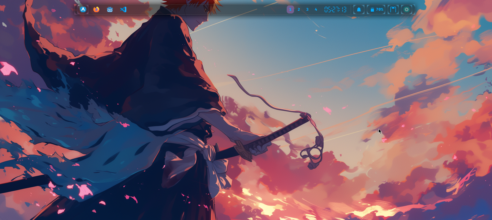
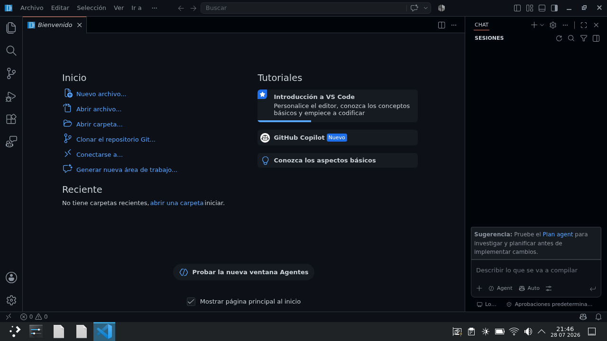
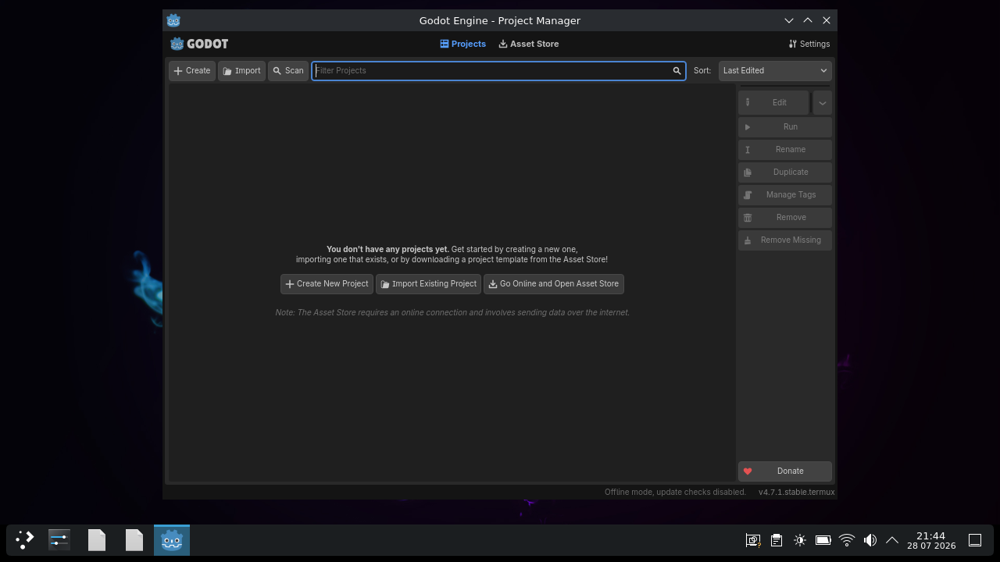
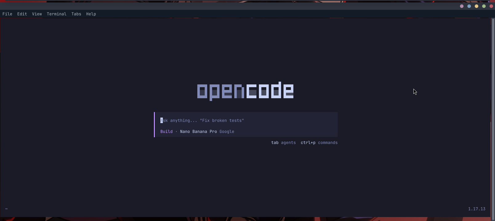
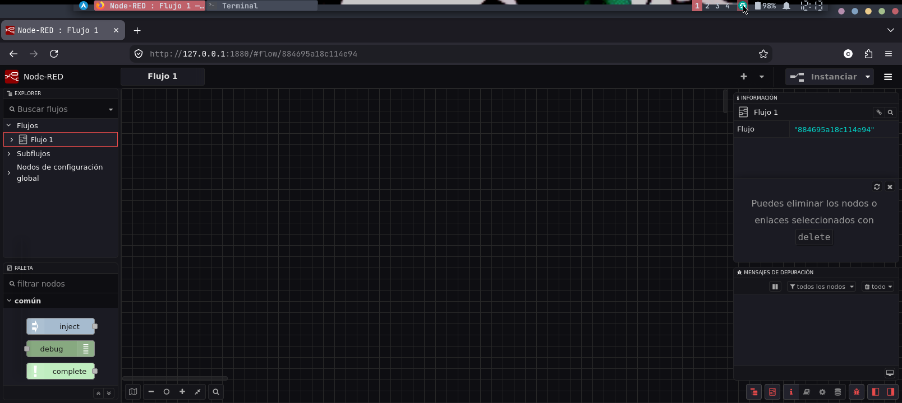
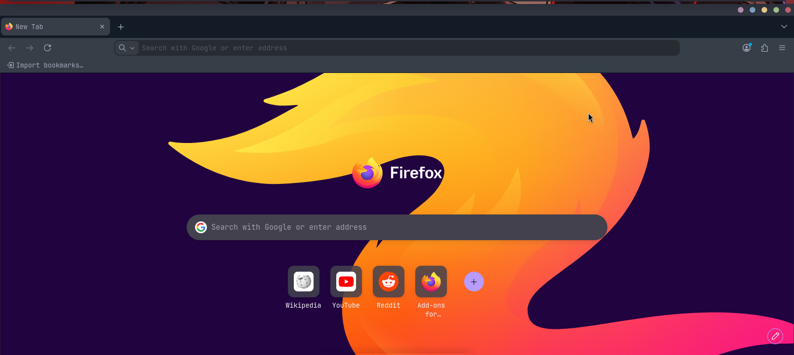

# 📱 Termux-Dev-Station: La Estación de Desarrollo Nativa Definitiva en Android
**Un proyecto de Systemic Flow**


<div align="center">

🌐 **Idiomas disponibles / Available Languages:**

[🇺🇸 English](README.md) | [🇪🇸 Español](README_ES.md) | [🇨🇳 中文](README_ZH.md) | [🇧🇷 Português](README_PT.md)

</div>

¡Bienvenido! Si alguna vez has querido transformar tu dispositivo Android (en modo DeX, conectado a un monitor externo o directamente en tu tablet/móvil) en una auténtica computadora de desarrollo sin necesidad de root, pesadas capas de emulación, ni scripts mágicos y oscuros, estás en el lugar correcto.

Esta guía rompe con el mito de que necesitas instalar sistemas operativos enteros (PRoot/Chroot) para programar de verdad en un teléfono. Aquí combinamos **rendimiento nativo, editores ligeros y aceleración gráfica directa** para construir un entorno 100% estable. 

La guía une lo mejor de dos mundos: **una explicación amigable, accesible y paso a paso** para que cualquier usuario comprenda qué ocurre en su dispositivo, junto con **la precisión técnica exacta**, comandos completos y scripts de automatización listos para exprimir tu hardware al máximo.

---

## 💡 Filosofía del Proyecto y Transparencia

He recorrido el camino de probar guías desactualizadas, emuladores lentos y scripts automáticos que instalan distribuciones de Linux enteras y terminan sobrecargando la memoria y la batería del dispositivo sin que sepas qué pasó. Esta guía es diferente: **es 100% nativa de Termux/NewTermux** y no utiliza automatizaciones a ciegas.

Aquí no hay capas intermedias. Usamos el ecosistema puro de Termux para lograr el rendimiento real del hardware:
* **Desarrollo Web y Servidores:** Entorno completo con Node.js, Python y automatizaciones visuales con Node-RED.
* **Gamedev Nativo con Godot 4:** Creación de proyectos y exportación de paquetes APK de depuración sin salir del teléfono ni requerir un PC.
* **Tríada de Conocimiento Offline:** Acceso instantáneo a documentación técnica (DevDocs, MDN, ArchWiki, Godot Docs) y repositorios locales de GitHub mediante RepoView sin internet.
* **IA Autónoma Respaldada en la Nube:** Asistencia de programación en terminal impulsada por Google Gemini mediante **Antigravity CLI**, consumiendo 0 MB de memoria RAM local.
* **Aceleración Gráfica Híbrida:** Escritorio XFCE seguro por CPU y GPU bajo demanda para aplicaciones 3D pesadas.
* **Ocupación Menor a 7 GB:** Todo un entorno de ingeniería multidisciplinario que ocupa menos de 6.95 GB de almacenamiento base, mantenido con un script de limpieza profunda.

---

## 🖼️ Vista Previa del Entorno

Así es como luce tu estación de trabajo una vez completado el proceso y aplicada la personalización de Systemic Flow:

| Escritorio XFCE (Optimizado y Moderno) | Editor de código (Code OSS) |
| :---: | :---: |
|  |  |

| Godot Engine 4 (Exportación Android) | Modelado 3D (Blockbench GPU) |
| :---: | :---: |
|  |  |

| Automatización con Node-RED | Navegación Web Blindada (Firefox) |
| :---: | :---: |
|  |  |

---

## 📍 Índice de Contenidos

1. [⚡ Arquitectura Híbrida de Aceleración (VirGL + Vulkan + ANGLE)](#-arquitectura-híbrida-de-aceleración-virgl--vulkan--angle)
2. [📋 Entorno y Servidor Gráfico](#-entorno-y-servidor-gráfico)
3. [🚀 Paso Previo: Preparando la Terminal (NewTermux Recomendado)](#-paso-previo-preparando-la-terminal-newtermux-recomendado)
4. [🛠️ Guía de Instalación Paso a Paso (Manual)](#️-guía-de-instalación-paso-a-paso-manual)
   * [Fase 1: Preparación del Sistema Base](#fase-1-preparación-del-sistema-base)
   * [Fase 2: Repositorios, Utilidades del Sistema y Capa de Aceleración Gráfica (VirGL)](#fase-2-repositorios-utilidades-del-sistema-y-capa-de-aceleración-gráfica-virgl)
   * [Fase 3: Asistente de IA Autónomo (Antigravity CLI) y Configuración de Claves SSH](#fase-3-asistente-de-ia-autónomo-antigravity-cli-y-configuración-de-claves-ssh)
   * [Fase 4: Despliegue de Node-RED y Limpieza Inteligente de Espacio](#fase-4-despliegue-de-node-red-y-limpieza-inteligente-de-espacio)
   * [Fase 5: Instalación del Escritorio XFCE, Servidores Gráficos y Herramientas](#fase-5-instalación-del-escritorio-xfce-servidores-gráficos-y-herramientas)
   * [Fase 6: Solución al Bloqueo de Procesos Fantasma (Android 12+)](#fase-6-solución-al-bloqueo-de-procesos-fantasma-android-12)
   * [Fase 7: Configuración de Arranque (`xstartup` para VNC)](#fase-7-configuración-de-arranque-xstartup-para-vnc)
   * [Fase 8: Personalización Visual, Terminal Gráfica y Despliegue de Assets](#fase-8-personalización-visual-terminal-gráfica-y-despliegue-de-assets)
   * [Fase 9: Habilitar Aceleración GPU en Lanzadores (Opcional)](#fase-9-habilitar-aceleración-gpu-en-lanzadores-opcional)
   * [Fase 10: Suite Godot 4, Estructura Android SDK y Editor Externo Seguro](#fase-10-suite-godot-4-estructura-android-sdk-y-editor-externo-seguro)
   * [Fase 11: Tríada de Documentación Offline (Kiwix, Web Docs y RepoView)](#fase-11-tríada-de-documentación-offline-kiwix-web-docs-y-repoview)
5. [🕹️ Scripts de Automatización del Sistema](#️-scripts-de-automatización-del-sistema)
6. [📜 Licencia](#-licencia)
   
---
   
## ⚡ Arquitectura Híbrida de Aceleración (VirGL + Vulkan + ANGLE)

A diferencia de la mayoría de guías limitadas a procesadores Snapdragon (Adreno/Turnip), esta configuración habilita la **aceleración gráfica por GPU real en procesadores con GPU Mali** (MediaTek Dimensity/Helio, Exynos, Unisoc) mediante una cadena de traducción nativa. 

El verdadero secreto del rendimiento de Systemic Flow radica en nuestra **arquitectura bajo demanda**:
1. Renderizamos el entorno de escritorio por software (CPU llvmpipe) para garantizar una estabilidad absoluta, eliminando de raíz las pantallas negras y los cuelgues (errores `BadMatch`).
2. Delegamos el procesamiento 3D a la GPU de forma aislada **solo** para las aplicaciones que lo exigen (como Godot Engine, Blockbench o Firefox).

Con este método, el rendimiento se dispara, la fluidez es total y tu dispositivo se mantiene fresco (~36 °C) incluso bajo tareas pesadas.

---

## 📋 Entorno y Servidor Gráfico

Para asegurar que tu dispositivo rinda al máximo sin devorar la memoria RAM:

### 1. El Escritorio: XFCE4
* **XFCE:** Ligero, sumamente rápido y minimalista. Es el estándar de esta guía. Con nuestros paneles personalizados y el menú Whisker, ofrece una interfaz moderna consumiendo una fracción mínima de recursos.

### 2. Elección del Servidor Gráfico (Display Server)
* **X11 Nativo (`termux-x11-nightly`):** Renderizado directo en la pantalla del dispositivo mediante su app dedicada (`DISPLAY=:0`), ofreciendo la menor latencia de entrada y soporte táctil fluido. Es la opción principal recomendada.
* **Servidor VNC (TigerVNC):** Ideal para trabajar en monitores externos sin cables conectándote a `127.0.0.1:5901`.

*Instalaremos ambas opciones para que tengas total flexibilidad.*

---

## 🚀 Paso Previo: Preparando la Terminal (NewTermux Recomendado)

Para obtener la mejor experiencia visual y ergonomía al programar, recomendamos instalar **[NewTermux](https://github.com/Neo-Termux)** (o la versión oficial `arm64-v8a` de Termux desde sus Releases de GitHub):

* **¿Por qué NewTermux?** Incorpora una interfaz táctil modernizada, una barra de teclas virtuales extendida optimizada para desarrollo, renderizado de fuentes mejorado y una estética alineada con el estilo Tokyo Night de Systemic Flow.
* **Compatibilidad:** Mantiene el 100% de compatibilidad binaria con los repositorios y rutas estándar (`/data/data/com.termux/files/...`), por lo que todos los scripts, comandos y rutas de Godot de esta guía funcionan de forma idéntica sin cambiar nada.

---

## 🛠️ Guía de Instalación Paso a Paso (Manual)

### Fase 1: Preparación del Sistema Base
Otorgamos permisos de almacenamiento, actualizamos espejos (opcional si deseas cambiar de servidor) y ponemos al día los paquetes del sistema:

```bash
termux-setup-storage
termux-change-repo  # (Opcional: selecciona los espejos más rápidos)
apt list --upgradable
apt full-upgrade -y
```

### Fase 2: Repositorios, Utilidades del Sistema y Capa de Aceleración Gráfica (VirGL)
Añadimos los repositorios comunitarios esenciales (`tur-repo`, `x11-repo`), herramientas de desarrollo, utilidades para gestión de procesos (`procps` para `killall` y `pkill`), decoraciones de terminal (`figlet`, `neofetch`), servidor Kiwix (`kiwix-tools`) y preparamos la capa de aceleración gráfica para procesadores Mali mediante ANGLE y Vulkan:

```bash
pkg install tur-repo x11-repo android-tools -y
pkg install git unzip wget curl ripgrep procps figlet neofetch kiwix-tools -y
pkg install virglrenderer virglrenderer-android angle-android vulkan-loader-generic openssl -y

# 1. Eliminar renderizadores por software conflictivos si existieran
pkg remove '*icd-swrast' 2>/dev/null

# 2. Instalar el wrapper de Vulkan para Mesa
wget 'https://github.com/ar37-rs/virgl-angle/releases/download/latest/mesa-vulkan-icd-wrapper_25.0.0-1_aarch64.deb'
dpkg -i mesa-vulkan-icd-wrapper_25.0.0-1_aarch64.deb
rm mesa-vulkan-icd-wrapper_25.0.0-1_aarch64.deb

# 3. Instalar herramienta vgl para gestionar el arranque del servidor gráfico
wget 'https://github.com/ar37-rs/virgl-angle/raw/refs/heads/main/vgl'
chmod +x vgl && mv vgl $PREFIX/bin/
```

### Fase 3: Asistente de IA Autónomo (Antigravity CLI) y Configuración de Claves SSH
En lugar de agotar la memoria RAM con modelos locales lentos, desplegamos **[Antigravity CLI](https://github.com/wallentx/antigravity-cli-termux)** para asistencia de código instantánea impulsada por Gemini en la nube, junto a la autenticación automática con GitHub:

1. **Instalar dependencias glibc y desplegar Antigravity CLI:**
   ```bash
   pkg install glibc-repo -y
   pkg install glibc ca-certificates resolv-conf -y
   curl -fsSL https://raw.githubusercontent.com/wallentx/antigravity-cli-termux/dev/install.sh | bash
   ```

2. **Generar Clave SSH para GitHub:**
   ```bash
   # Generar clave Ed25519 (presiona Enter para aceptar la ruta por defecto)
   ssh-keygen -t ed25519 -C "tu-correo-de-github@ejemplo.com"

   # Mostrar clave pública para copiarla en GitHub (Settings > SSH and GPG keys)
   cat ~/.ssh/id_ed25519.pub
   ```

3. **Configurar Entorno de Inicio (`~/.bashrc`):**
   Configura un archivo de inicio limpio con persistencia del agente SSH, alias de GPU bajo demanda, colores True Color y límites de seguridad de memoria:
```bash
cat << 'EOF' > ~/.bashrc
# Configuración de Idioma / Localización
export LANG=es_ES.UTF-8
export LANGUAGE=es_ES.UTF-8
export LC_ALL=C.UTF-8

# Alias para habilitar GPU bajo demanda en apps 3D (ej: gpu godot)
alias gpu='env -u LIBGL_ALWAYS_SOFTWARE GALLIUM_DRIVER=virpipe MESA_GL_VERSION_OVERRIDE=4.1COMPAT MESA_GLSL_VERSION_OVERRIDE=410'

# Red de seguridad monoproceso para Firefox (evita cierres por falta de RAM)
export MOZ_FORCE_DISABLE_E10S=1

# Limitar memoria del recolector de basura de Node.js a 512 MB
export NODE_OPTIONS="--max-old-space-size=512"

# Autoarranque del agente SSH
eval "$(ssh-agent -s)" >/dev/null 2>&1
ssh-add ~/.ssh/id_ed25519 >/dev/null 2>&1

# Soporte True Color de 24 bits para Starship
export COLORTERM=truecolor
export TERM=xterm-256color

eval "$(starship init bash)"
alias ls="lsd"

clear
echo 'Systemic Flow Dev Station' | figlet 2>/dev/null || echo 'Termux Dev Station'
neofetch 2>/dev/null || true
EOF
source ~/.bashrc
```

### Fase 4: Despliegue de Node-RED y Limpieza Inteligente de Espacio
Instalamos la plataforma liviana de automatización por eventos (Node-RED) y realizamos una rutina de limpieza profunda:

```bash
curl -o termux-nodered-native.sh 'https://raw.githubusercontent.com/Yerensoncasares/termux-dev-station/main/termux-nodered-native.sh'
chmod +x termux-nodered-native.sh
bash termux-nodered-native.sh

# Rutina de limpieza de almacenamiento
npm cache clean --force && pip cache purge 2>/dev/null
pkg clean && apt autoremove --purge -y
rm -rf $PREFIX/tmp/*
```

### Fase 5: Instalación del Escritorio XFCE, Servidores Gráficos y Herramientas
Instalamos el entorno gráfico XFCE4, los servidores de visualización (`TigerVNC` y `termux-x11-nightly`), RepoView y la suite de desarrollo nativa (PulseAudio es resuelto automáticamente por XFCE):

```bash
# Entorno XFCE ultraligero y aplicaciones básicas
pkg install xfce4 xfce4-goodies thunar htop xfce4-places-plugin picom geany qgit audacity mtpaint -y 

# Servidores gráficos y herramientas de sistema
pkg install tigervnc termux-x11-nightly -y  # Servidor X11 nativo de alta fluidez

# Aplicaciones de desarrollo nativas (Node.js ya fue instalado por Node-RED)
pkg install python code-oss godot firefox -y

# Instalar RepoView globalmente para navegación offline de GitHub
npm install -g repoview
```

### Fase 6: Solución al Bloqueo de Procesos Fantasma (Android 12+)
Para evitar que Android mate tus procesos en segundo plano al cambiar de app, utiliza ADB Inalámbrico desde Opciones de Desarrollador:

```bash
adb pair 192.168.xxx.xxx:xxxxx
adb connect 192.168.xxx.xxx:xxxxx
adb shell "/system/bin/device_config set_sync_disabled_for_tests persistent"
adb shell "/system/bin/device_config put activity_manager max_phantom_processes 2147483647"
adb shell settings put global settings_enable_monitor_phantom_procs false
```

### Fase 7: Configuración de Arranque (`xstartup` para VNC)
Si decides usar VNC, configura tu archivo de inicio `~/.vnc/xstartup`:

1. Inicializa el servidor VNC para generar la estructura:
   ```bash
   vncserver && vncserver -kill :1
   ```
2. Edita `~/.vnc/xstartup`:
```bash
cat << 'EOF' > ~/.vnc/xstartup
#!/data/data/com.termux/files/usr/bin/sh

export localhost="no"

# Forzar renderizado por software para estabilidad del escritorio
export LIBGL_ALWAYS_SOFTWARE=1
export GALLIUM_DRIVER=llvmpipe
export DISPLAY=:1

xset s off &
xset -dpms &

# Localización y variables temporales
export LANG=es_ES.UTF-8
export LANGUAGE=es_ES.UTF-8
export LC_ALL=C.UTF-8
export TMPDIR=/data/data/com.termux/files/usr/tmp
export XDG_RUNTIME_DIR=${TMPDIR}

# Cargar recursos y lanzar sesión XFCE
[ -r $HOME/.Xresources ] && xrdb $HOME/.Xresources
dbus-launch --exit-with-session startxfce4
EOF
chmod +x ~/.vnc/xstartup
```

---

### Fase 8: Personalización Visual, Terminal Gráfica y Despliegue de Assets
Equipamos el escritorio con tipografía Tokyo Night, animaciones suaves con Picom, fuentes Nerd Fonts sincronizadas y lanzadores personalizados:

#### 1. Temas Base y Starship Prompt
```bash
# 1. Utilidades base, fuentes y temas
pkg install arc-gtk-theme papirus-icon-theme starship lsd fontconfig-utils -y

# 2. Configuración de terminal (Starship preset Tokyo Night)
mkdir -p ~/.config
starship preset tokyo-night -o ~/.config/starship.toml

# 3. Asegurar que la terminal gráfica de XFCE lea el ~/.bashrc
echo '[ -f ~/.bashrc ] && . ~/.bashrc' >> ~/.bash_profile
```

#### 2. Despliegue de Assets v1.0.2 (Temas, Iconos, Configuraciones y Suite de Apps)
Descargamos el paquete oficial de Systemic Flow v1.0.2, desplegamos las configuraciones visuales completas (paneles XFCE, Picom, GTK, iconos y lanzadores) y eliminamos los temporales:

```bash
# 1. Limpieza preventiva y descarga del paquete v1.0.2
rm -rf ~/.fonts ~/.themes ~/.icons ~/assets.zip.001 ~/assets
curl -L -o ~/assets.zip.001 "https://github.com/Yerensoncasares/termux-dev-station/releases/download/V1.0.2/assets.zip.001"

# 2. Extraer paquete en el directorio raíz (genera automáticamente ~/assets/)
unzip -qo ~/assets.zip.001 -d ~/ && rm ~/assets.zip.001

# 3. Desplegar temas, fuentes e iconos base
cp -rf ~/assets/.icons ~/assets/.themes ~/assets/.fonts ~/
fc-cache -fv

# 4. Desplegar iconos personalizados de aplicaciones
mkdir -p ~/.local/share/icons
cp -rf ~/assets/icons/* ~/.local/share/icons/ 2>/dev/null || true

# 5. Copiar configuraciones completas (xfce4, gtk-3.0, picom, autostart, terminalrc)
mkdir -p ~/.config
cp -rf ~/assets/config/* ~/.config/

# 6. Instalar lanzadores (Blockbench, DevDocs, Kiwix, Python Docs, RepoView)
mkdir -p ~/.local/share/applications
cp -rf ~/assets/applications/* ~/.local/share/applications/ 2>/dev/null || true
update-desktop-database ~/.local/share/applications/ 2>/dev/null || true

# 7. Mover módulos de servidor e interfaz (Python UI y Kiwix UI) a $HOME
cp -rf ~/assets/docs/mi_kiwix_ui ~/assets/docs/mi_ui_python ~/

# 8. Desplegar repositorios locales para RepoView
mkdir -p ~/storage/downloads/repos
cp -rf ~/assets/repos/* ~/storage/downloads/repos/ 2>/dev/null || true

# 9. Eliminar carpeta temporal extraída
rm -rf ~/assets

# 10. Desactivar compositor de XFCE (para que Picom tome el control)
xfconf-query -c xfwm4 -p /general/use_compositing -s false 2>/dev/null || true

# 11. Integración en ~/.bashrc
source ~/.bashrc
```

#### 3. Perfil de Blindaje de Memoria para Firefox (`user.js`)
Para evitar picos de memoria que activen el Low Memory Killer (LMK) de Android al navegar en sitios pesados o DevDocs, inyectamos límites de memoria estrictos en Firefox:

```bash
for profile in ~/.mozilla/firefox/*.default* ~/.mozilla/firefox/*.default-release*; do
  if [ -d "$profile" ]; then
    cat << 'EOF' > "$profile/user.js"
// === BLINDAJE DE MEMORIA SYSTEMIC FLOW ===
user_pref("browser.cache.memory.enable", true);
user_pref("browser.cache.memory.capacity", 32768); // Limitar caché en RAM a 32MB
user_pref("browser.sessionhistory.max_total_viewers", 1); // Desactivar bfcache
user_pref("browser.sessionhistory.max_entries", 10);
user_pref("browser.tabs.unloadOnLowMemory", true); // Suspender pestañas inactivas
user_pref("media.memory_cache_max_size", 16384);
user_pref("extensions.pocket.enabled", false);
user_pref("toolkit.telemetry.enabled", false);
user_pref("dom.ipc.processCount", 1);
user_pref("browser.tabs.remote.autostart", false);
EOF
  fi
done
```

---

### Fase 9: Habilitar Aceleración GPU en Lanzadores (Opcional)
Nuestra arquitectura renderiza la interfaz por software por defecto para máxima estabilidad, pero puedes habilitar la GPU bajo demanda para aplicaciones pesadas:

* **Code-OSS (VS Code):** Renderizado **por software** (`LIBGL_ALWAYS_SOFTWARE=1`) para evitar errores de Electron.
* **Firefox y Godot Engine:** Utilizan la **GPU bajo demanda** (`GALLIUM_DRIVER=virpipe`) para respuesta 3D fluida.

Para abrirlos directamente desde el Menú Whisker o el Panel inferior (clic derecho > **Editar aplicación**):

* **Code-OSS:** `env LIBGL_ALWAYS_SOFTWARE=1 /data/data/com.termux/files/usr/bin/code-oss %F`
* **Firefox:** `env MOZ_FORCE_DISABLE_E10S=1 -u LIBGL_ALWAYS_SOFTWARE GALLIUM_DRIVER=virpipe MESA_GL_VERSION_OVERRIDE=4.1COMPAT MESA_GLSL_VERSION_OVERRIDE=410 firefox --single-process %u`
* **Godot Engine:** `env -u LIBGL_ALWAYS_SOFTWARE GALLIUM_DRIVER=virpipe MESA_GL_VERSION_OVERRIDE=4.1COMPAT MESA_GLSL_VERSION_OVERRIDE=410 godot %u`

---

### Fase 10: Suite Godot 4, Estructura Android SDK y Editor Externo Seguro

Godot en Termux no requiere descargar el SDK completo oficial de Google (cuyos binarios son exclusivos de x86_64). Únicamente valida una estructura de directorios estándar y las utilidades nativas de depuración y firma.

> **Nota Técnica:** Al instalar `apksigner`, Termux resuelve e instala automáticamente **Java 21 OpenJDK** (`openjdk-21`) como dependencia directa.

#### 1. Preparar Herramientas y Enlaces Simbólicos
```bash
# 1. Instalar herramientas de Android (incluye automáticamente Java 21)
pkg install android-tools apksigner -y

# 2. Crear carpetas requeridas por la interfaz de Godot
mkdir -p ~/android-sdk/platform-tools
mkdir -p ~/android-sdk/build-tools/36.0.0
mkdir -p ~/.local/share/godot/keystores

# 3. Enlazar adb a la carpeta platform-tools
ln -sf $(which adb) ~/android-sdk/platform-tools/adb

# 4. Enlazar apksigner a la carpeta build-tools
ln -sf $(which apksigner) ~/android-sdk/build-tools/36.0.0/apksigner

# 5. Generar Debug Keystore
if [ ! -f ~/.local/share/godot/keystores/debug.keystore ]; then
    keytool -genkey -v -keystore ~/.local/share/godot/keystores/debug.keystore \
      -storepass android -alias androiddebugkey -keypass android -keyalg RSA \
      -keysize 2048 -validity 10000 -dname "CN=Android Debug,O=Android,C=US"
fi
```

#### 2. Crear Wrapper Seguro para Code-OSS en Godot
Como Godot corre con GPU activa (`GALLIUM_DRIVER=virpipe`), cualquier subproceso hijo hereda esta variable. Las aplicaciones Electron (Code-OSS) crashean al heredar VirGL. Creamos un wrapper permanente:

```bash
cat << 'EOF' > $PREFIX/bin/code-oss-safe
#!/data/data/com.termux/files/usr/bin/sh
unset GALLIUM_DRIVER
unset MESA_GL_VERSION_OVERRIDE
unset MESA_GLSL_VERSION_OVERRIDE
export LIBGL_ALWAYS_SOFTWARE=1
exec $PREFIX/bin/code-oss "$@"
EOF
chmod +x $PREFIX/bin/code-oss-safe
```

#### 3. Configurar Rutas en el Editor de Godot
Abre Godot (`gpu godot`), ve a **Editor > Configuración del Editor > Exportar > Android** e ingresa las rutas exactas:

* **Java SDK Path:** `/data/data/com.termux/files/usr/lib/jvm/java-21-openjdk`
* **Android SDK Path:** `/data/data/com.termux/files/home/android-sdk`
* **Debug Keystore:** `/data/data/com.termux/files/home/.local/share/godot/keystores/debug.keystore`
* **Usuario Debug Keystore:** `androiddebugkey`
* **Contraseña Debug Keystore:** `android`

*(Opcional: En **Editor de Texto > Externo**, define la ruta en `/data/data/com.termux/files/usr/bin/code-oss-safe` y las banderas en `{project} --goto {file}:{line}:{col}`)*.

---

### Fase 11: Tríada de Documentación Offline (Kiwix, Web Docs y RepoView)

Para lograr independencia total de internet y evitar información no verificada en la web abierta, la estación integra tres motores locales de documentación y código:

1. **Biblioteca Kiwix (`kiwix.zip.*`):** Paquete de 8 partes con archivos `.zim` que contienen la **ArchWiki** completa, documentación de Termux, cursos de FreeCodeCamp, Bootstrap y libros universitarios de LibreTexts (matemáticas e ingeniería).
2. **Suite Web y Libros (`python.zip.*`):** Paquete de 3 partes con sitios web completos preparados para navegación local: la biblia web de **MDN**, documentación oficial de **Godot**, tutoriales interactivos de **learn-gdscript** y la biblioteca de **librosgratis.dev**.
3. **Repositorios Locales RepoView (`repos/`):** Visor completo tipo GitHub en local con vista previa de Markdown, diffs y árbol de archivos.

---

#### 📥 1. Descarga Directa por Terminal (Opcional)
Puedes descargar todas las partes divididas directamente a tu carpeta de descargas sin abrir el navegador:

```bash
cd ~/storage/downloads
BASE_URL="https://github.com/Yerensoncasares/termux-dev-station/releases/download/V1.0.2"

# Descargar las 3 partes de Python / Web Docs
for p in 001 002 003; do
  wget -c --show-progress "$BASE_URL/python.zip.$p"
done

# Descargar las 8 partes de Kiwix
for k in 001 002 003 004 005 006 007 008; do
  wget -c --show-progress "$BASE_URL/kiwix.zip.$k"
done
```

---

#### 📦 2. Reconstrucción y Extracción de Paquetes
Una vez descargadas las partes, únelas y extráelas en un solo paso mediante `cat`:

```bash
cd ~/storage/downloads

# 1. Unir y extraer la Biblioteca Kiwix (8 partes -> Descargas/kiwix/)
cat kiwix.zip.* > kiwix_temp.zip
unzip -qo kiwix_temp.zip -d ~/storage/downloads/
rm kiwix_temp.zip

# 2. Unir y extraer la Suite Web / Libros (3 partes -> Descargas/python/)
cat python.zip.* > python_temp.zip
unzip -qo python_temp.zip -d ~/storage/downloads/
rm python_temp.zip
```

> **Nota:** No es necesario crear subcarpetas manualmente; cada archivo comprimido genera automáticamente sus directorios raíz (`kiwix/` y `python/`). Si deseas ahorrar espacio, puedes eliminar los archivos divididos `.zip.001`, `.zip.002`, etc., una vez extraídos.

---

#### 🚀 3. Acceso a las Bibliotecas
* **Desde el Escritorio XFCE:** Puedes abrir cualquiera de los centros de documentación con un solo clic desde el Menú Whisker:
  * **Kiwix Docs Offline** ➔ Abre Kiwix en el puerto 8080.
  * **Web & Godot Docs Offline** ➔ Abre el servidor de documentación Python en el puerto 8081.
  * **RepoView Offline** ➔ Abre el navegador local de repositorios en el puerto 8082.
* **Desde la Terminal:** 
  * `Kw`: Inicia Kiwix (`http://localhost:8080`).
  * `Py`: Inicia Servidor de Docs Python (`http://localhost:8081`).
  * `Rp`: Inicia sesión de RepoView (`http://localhost:8082`).

---

## 🕹️ Scripts de Automatización del Sistema

Todos los scripts residen en `$PREFIX/bin/` para ser invocados directamente desde cualquier terminal.

### 1. Script de Actualización del Sistema (`up`)
```bash
cat << 'EOF' > $PREFIX/bin/up
#!/data/data/com.termux/files/usr/bin/bash
apt list --upgradable
yes | pkg update && pkg upgrade -y
EOF
chmod +x $PREFIX/bin/up
```

### 2. Script de Encendido Gráfico X11 Nativo (`on`)
```bash
cat << 'EOF' > $PREFIX/bin/on
#!/data/data/com.termux/files/usr/bin/bash

termux-wake-lock
am force-stop com.termux.x11 2>/dev/null
pkill -9 -f termux-x11 2>/dev/null
vgl q 2>/dev/null
pkill -9 -f virgl 2>/dev/null
pkill -9 -f picom 2>/dev/null
sleep 1

TMPDIR=/data/data/com.termux/files/usr/tmp
rm -rf "$TMPDIR"/.X11-unix/X* "$TMPDIR"/dbus-* "$TMPDIR"/pulse-* "$HOME"/.cache/sessions/*

# Levantar servidor gráfico en modo Vulkan
vgl angle=vulkan &
sleep 2

# Iniciar X11 y la app de Android
export DISPLAY=:0
termux-x11 :0 -ac &
sleep 2
am start --user 0 -n com.termux.x11/.MainActivity >/dev/null 2>&1

# Configuración de audio y entorno seguro
pulseaudio --start --exit-idle-time=-1 2>/dev/null
export LANG=es_ES.UTF-8
export LIBGL_ALWAYS_SOFTWARE=1
export GALLIUM_DRIVER=llvmpipe

[ -r $HOME/.Xresources ] && xrdb $HOME/.Xresources

# Arranque limpio y nativo de XFCE (Picom se levantará vía autostart)
dbus-run-session -- startxfce4
EOF
chmod +x $PREFIX/bin/on
```

### 3. Script de Encendido VNC (`vnc-on`)
```bash
cat << 'EOF' > $PREFIX/bin/vnc-on
#!/data/data/com.termux/files/usr/bin/bash

termux-wake-lock
export TMPDIR=/data/data/com.termux/files/usr/tmp
export DISPLAY=:1

# 1. Limpieza extrema previa
vncserver -kill :1 >/dev/null 2>&1
rm -rf "$TMPDIR"/.X11-unix/X1 "$TMPDIR"/dbus-* "$TMPDIR"/pulse-* "$HOME"/.vnc/*.pid "$HOME"/.vnc/*.log

# 2. Levantar servidor gráfico en modo Vulkan
vgl q 2>/dev/null
pkill -9 -f virgl 2>/dev/null
vgl angle=vulkan &
sleep 2
sync

# 3. Audio
pulseaudio --start --exit-idle-time=-1 2>/dev/null

# 4. Iniciar VNC con sincronización garantizada
vncserver :1 -geometry 1280x720 -depth 24 -localhost no
echo -e "\n[✓] Servidor VNC iniciado. Conéctate con tu visor en: 127.0.0.1:5901"
renice -n -10 -p $(pgrep -f vncserver) 2>/dev/null
EOF
chmod +x $PREFIX/bin/vnc-on
```

### 4. Servidor de Documentación Offline Kiwix (`Kw`)
```bash
cat << 'EOF' > $PREFIX/bin/Kw
#!/data/data/com.termux/files/usr/bin/bash

LIBRARY_DIR="$HOME/mi_kiwix_ui"
LIBRARY_XML="$LIBRARY_DIR/cursos_library.xml"
ZIM_PATH="$HOME/storage/downloads/kiwix"
PORT=8080

mkdir -p "$LIBRARY_DIR"

# Liberar puerto 8080 si estaba ocupado
fuser -k $PORT/tcp 2>/dev/null || pkill -f "kiwix-serve" 2>/dev/null

echo "[+] Indexando archivos .zim desde $ZIM_PATH..."
if ls "$ZIM_PATH"/*.zim 1> /dev/null 2>&1; then
    for zim in "$ZIM_PATH"/*.zim; do
        kiwix-manage "$LIBRARY_XML" add "$zim"
    done
    echo "[✓] Documentos indexados correctamente."
else
    echo "[!] No se encontraron archivos .zim en $ZIM_PATH."
fi

echo "[+] Levantando servidor Kiwix en http://127.0.0.1:$PORT..."
if [ -f "$LIBRARY_DIR/index.html" ]; then
    kiwix-serve --port=$PORT -c "$LIBRARY_DIR/index.html" --library "$LIBRARY_XML" --daemon
else
    kiwix-serve --port=$PORT --library "$LIBRARY_XML" --daemon
fi

echo "[✓] Kiwix ejecutándose en segundo plano. Abre tu navegador en http://localhost:$PORT"
EOF
chmod +x $PREFIX/bin/Kw
```

### 5. Lanzador Servidor UI Python (`Py`)
```bash
cat << 'EOF' > $PREFIX/bin/Py
#!/data/data/com.termux/files/usr/bin/bash
if [ -f "$HOME/mi_ui_python/server.py" ]; then
    echo "[+] Iniciando servidor local Python en el puerto 8081..."
    python3 "$HOME/mi_ui_python/server.py"
else
    echo "[!] Error: No se encontró el archivo $HOME/mi_ui_python/server.py"
fi
EOF
chmod +x $PREFIX/bin/Py
```

### 6. Lanzador de Sesión de Repositorios RepoView (`Rp`)
```bash
cat << 'EOF' > $PREFIX/bin/Rp
#!/data/data/com.termux/files/usr/bin/bash

PORT=8082
REPOS_DIR="$HOME/storage/downloads/repos"

# 1. Liberar puerto 8082 si quedó colgado
fuser -k $PORT/tcp 2>/dev/null || pkill -f "repoview" 2>/dev/null
sleep 1

if [ ! -d "$REPOS_DIR" ]; then
    echo "[!] No se encontró el directorio: $REPOS_DIR"
    exit 1
fi

echo "[+] Iniciando servidor local RepoView en puerto $PORT..."
FIRST_REPO=$(find "$REPOS_DIR" -mindepth 1 -maxdepth 1 -type d | head -n 1)

if [ -z "$FIRST_REPO" ]; then
    echo "[!] No hay repositorios dentro de $REPOS_DIR"
    exit 1
fi

# Iniciar servidor en segundo plano con el primer repo
repoview --repo "$FIRST_REPO" --port $PORT > /dev/null 2>&1 &
sleep 2

# Registrar todos los demás repositorios en la misma sesión
for repo in "$REPOS_DIR"/*/; do
    [ -d "$repo" ] && [ "$repo" != "$FIRST_REPO/" ] && repoview --repo "$repo" --port $PORT > /dev/null 2>&1
done

echo "[✓] Todos los repositorios indexados. Sesión lista en: http://localhost:$PORT"
EOF
chmod +x $PREFIX/bin/Rp
```

### 7. Script de Apagado Limpio (`off`)
```bash
cat << 'EOF' > $PREFIX/bin/off
#!/data/data/com.termux/files/usr/bin/bash

termux-wake-unlock
export TMPDIR=/data/data/com.termux/files/usr/tmp

echo "Apagando estación de desarrollo..."

# 1. Matar entorno XFCE y Compositor
killall -9 xfce4-session startxfce4 xfwm4 xfdesktop xfce4-panel picom 2>/dev/null
pkill -9 -f picom 2>/dev/null

# 2. Detener Servidores Gráficos (VNC, X11 y Vulkan)
vncserver -kill :1 >/dev/null 2>&1
pkill -9 Xvnc 2>/dev/null
am force-stop com.termux.x11 2>/dev/null
pkill -9 -f termux-x11 2>/dev/null
vgl q 2>/dev/null
pkill -9 -f virgl 2>/dev/null

# 3. Detener demonios de soporte y servidores locales de documentación
killall -9 dbus-daemon 2>/dev/null
pulseaudio --kill 2>/dev/null
pkill -9 -f "kiwix-serve" 2>/dev/null
pkill -9 -f "mi_ui_python/server.py" 2>/dev/null
pkill -9 -f "repoview" 2>/dev/null

# 4. Liberar puertos de red por seguridad
fuser -k 8080/tcp 2>/dev/null
fuser -k 8081/tcp 2>/dev/null
fuser -k 8082/tcp 2>/dev/null

# 5. Limpieza profunda de temporales y memoria acumulada
rm -rf "$TMPDIR"/.X11-unix/X* "$TMPDIR"/dbus-* "$TMPDIR"/pulse-* 
rm -rf "$HOME"/.vnc/*.pid "$HOME"/.vnc/*.log "$HOME"/.cache/sessions/*

echo "[✓] Todo apagado y limpio. Memoria RAM liberada."
EOF
chmod +x $PREFIX/bin/off
```

### 8. Script de Limpieza Profunda del Sistema (`clean`)
Purga cachés de paquetes, elimina dependencias huérfanas, limpia cachés de npm/pip, vacía temporales de ejecución y limpia historiales del navegador para mantener el sistema por debajo de los 7 GB:
```bash
cat << 'EOF' > $PREFIX/bin/clean
#!/data/data/com.termux/files/usr/bin/bash

echo "Iniciando limpieza profunda de Systemic Flow..."

# 1. Caché de APT y paquetes del sistema
apt clean && pkg clean && apt autoremove --purge -y

# 2. Cachés de desarrollo (npm y pip)
npm cache clean --force 2>/dev/null || true
pip cache purge 2>/dev/null || true

# 3. Caché de miniaturas, fuentes y Firefox
rm -rf ~/.cache/thumbnails/* 2>/dev/null
rm -rf ~/.cache/fontconfig/* 2>/dev/null
rm -rf ~/.mozilla/firefox/*.default*/cache2/* 2>/dev/null
rm -rf ~/.mozilla/firefox/*.default*/startupCache/* 2>/dev/null

# 4. Archivos temporales y sockets en ejecución
rm -rf /data/data/com.termux/files/usr/tmp/* 2>/dev/null
rm -rf ~/.vnc/*.log 2>/dev/null

# 5. Eliminar residuos de Ollama si existieran
[ -d "$HOME/.ollama" ] && rm -rf "$HOME/.ollama"

echo "[✓] Limpieza profunda completada. Almacenamiento optimizado."
EOF
chmod +x $PREFIX/bin/clean
```

---

## 📜 Licencia
Este proyecto se distribuye bajo la licencia **MIT**. Desarrollado por **Systemic Flow**.