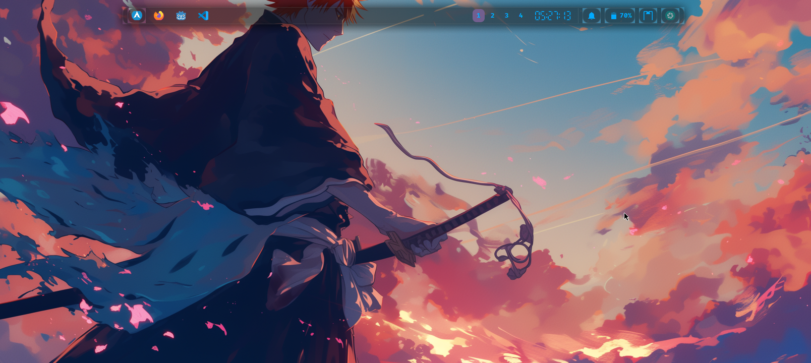
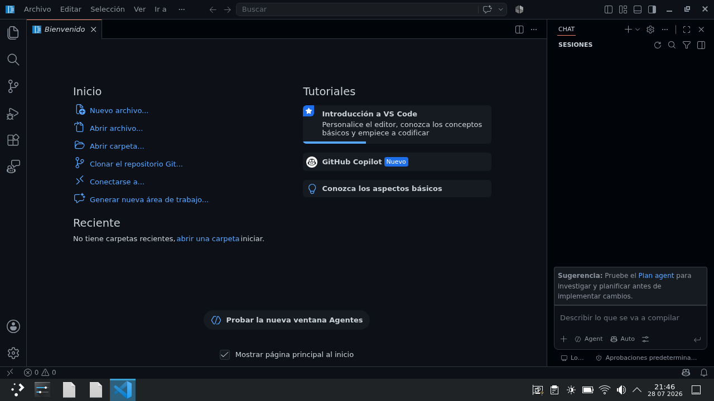
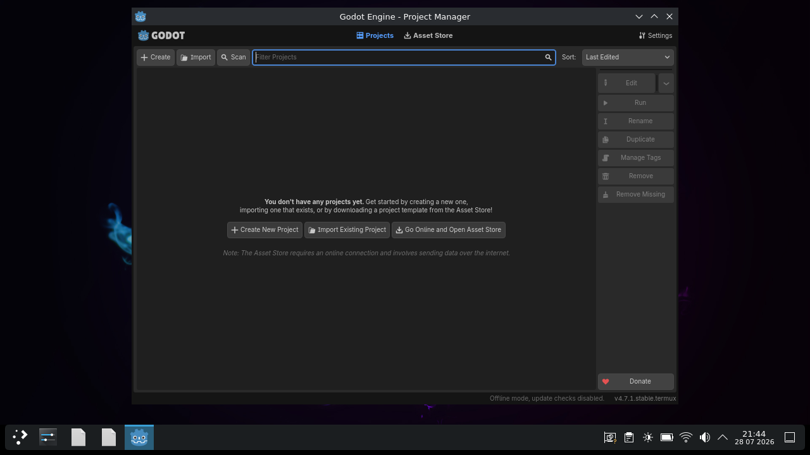
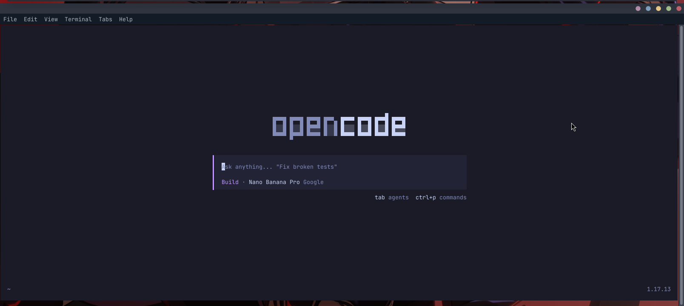
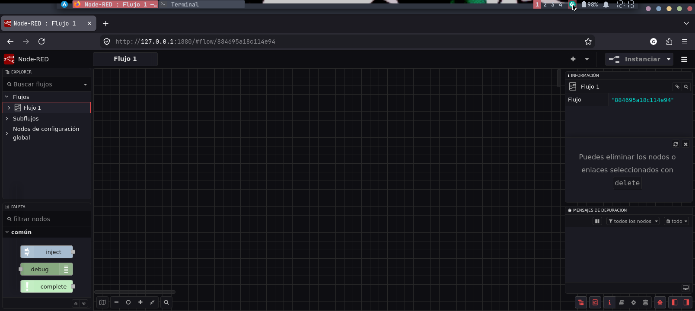
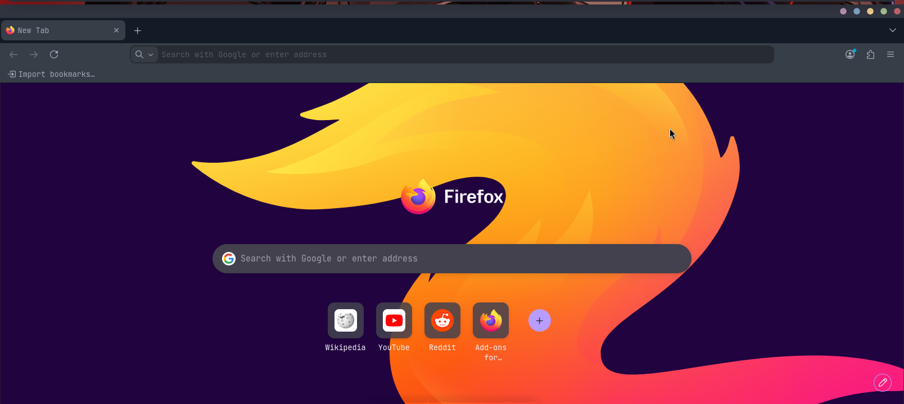

# 📱 Termux-Dev-Station: A Estação de Desenvolvimento Nativa Definitiva no Android
**Um projeto da Systemic Flow**


<div align="center">

🌐 **Idiomas disponíveis / Available Languages:**

[🇺🇸 English](README.md) | [🇪🇸 Español](README_ES.md) | [🇨🇳 中文](README_ZH.md) | [🇧🇷 Português](README_PT.md)

</div>

Seja bem-vindo! Se você já quis transformar seu dispositivo Android (no modo DeX, conectado a um monitor externo ou diretamente no seu celular/tablet) em um verdadeiro computador de desenvolvimento sem necessidade de root, pesadas camadas de emulação, nem scripts mágicos obscuros, você está no lugar certo.

Este guia quebra o mito de que você precisa instalar sistemas operacionais inteiros (PRoot/Chroot) para programar de verdade em um smartphone. Aqui combinamos **desempenho nativo, editores leves e aceleração gráfica direta por hardware** para construir um ambiente 100% estável.

O guia une o melhor de dois mundos: uma **explicação amigável, acessível e passo a passo** para que você entenda exatamente o que acontece no dispositivo, juntamente com a **precisão técnica exata**, comandos completos e scripts de automação prontos para extrair o máximo do seu hardware.

---

## 💡 Filosofia do Projeto e Transparência

Percorremos o caminho de testar tutoriais desatualizados, emuladores lentos e scripts automáticos que instalam distribuições Linux inteiras que acabam sobrecarregando a memória e a bateria do dispositivo sem explicação. Este guia é diferente: **é 100% nativo do Termux** e não utiliza automações cegas.

Não há camadas intermediárias. Usamos o ecossistema puro do Termux para alcançar o desempenho real do hardware:
* **Desenvolvimento Web e Servidores:** Ambiente completo com Node.js, Python e automações visuais com Node-RED.
* **GameDev Nativo com Godot 4:** Criação de projetos e exportação de pacotes APK de depuração sem sair do celular e sem precisar de um PC.
* **Documentação Offline com Kiwix e Web Docs:** Acesso instantâneo a documentação técnica essencial (DevDocs, MDN, ArchWiki, Godot Docs) localmente, sem gastar dados móveis.
* **Inteligência Artificial Integrada:** Modelos locais com Ollama orquestrados interativamente pelo **Shell-Agent**.
* **Aceleração Gráfica Híbrida:** Desktop XFCE seguro e estável por CPU com GPU sob demanda para aplicações 3D pesadas.

---

## 🖼️ Prévia do Ambiente

É assim que fica sua estação de trabalho após o processo completo e a aplicação da personalização da Systemic Flow:

| Desktop XFCE (Otimizado e Moderno) | Editor de Código (Code OSS) |
| :---: | :---: |
|  |  |

| Godot Engine 4 (Exportação Android) | Assistente de IA com Shell-Agent |
| :---: | :---: |
|  |  |

| Automação de Eventos (Node-RED) | Navegação Web (Firefox) |
| :---: | :---: |
|  |  |

---

## 📍 Índice de Conteúdos

1. [⚡ Arquitetura Híbrida de Aceleração (VirGL + Vulkan + ANGLE)](#-arquitetura-híbrida-de-aceleração-virgl--vulkan--angle)
2. [📋 Ambiente e Servidor Gráfico](#-ambiente-e-servidor-gráfico)
3. [🚀 Passo Prévio: Preparando o Termux](#-passo-prévio-preparando-o-termux)
4. [🛠️ Guia de Instalação Passo a Passo (Manual)](#️-guia-de-instalação-passo-a-passo-manual)
   * [Fase 1: Preparação do Sistema Base](#fase-1-preparação-do-sistema-base)
   * [Fase 2: Repositórios, Utilitários do Sistema e Camada de Aceleração Gráfica (VirGL)](#fase-2-repositórios-utilitários-do-sistema-e-camada-de-aceleração-gráfica-virgl)
   * [Fase 3: Assistente de Inteligência Artificial (Shell-Agent + Ollama)](#fase-3-assistente-de-inteligência-artificial-shell-agent--ollama)
   * [Fase 4: Implantação do Node-RED e Limpeza Inteligente de Espaço](#fase-4-implantação-do-node-red-e-limpeza-inteligente-de-espaço)
   * [Fase 5: Instalação do Desktop XFCE, Servidores Gráficos e Ferramentas](#fase-5-instalação-do-desktop-xfce-servidores-gráficos-e-ferramentas)
   * [Fase 6: Solução para o Bloqueio de Processos Fantasma (Android 12+)](#fase-6-solução-para-o-bloqueio-de-processos-fantasma-android-12)
   * [Fase 7: Configuração de Inicialização (`xstartup` para VNC)](#fase-7-configuração-de-inicialização-xstartup-para-vnc)
   * [Fase 8: Personalização Visual, Animações e Estética (Systemic Flow)](#fase-8-personalização-visual-animações-e-estética-systemic-flow)
   * [Fase 9: Habilitar Aceleração de GPU nos Lançadores (Opcional)](#fase-9-habilitar-aceleração-de-gpu-nos-lançadores-opcional)
   * [Fase 10: Suíte Godot 4 + Estrutura Nativa do Android SDK](#fase-10-suíte-godot-4--estrutura-nativa-do-android-sdk)
   * [Fase 11: Centro de Documentação Offline (Kiwix e Web Docs)](#fase-11-centro-de-documentação-offline-kiwix-e-web-docs)
5. [🕹️ Scripts de Automação do Sistema](#️-scripts-de-automação-do-sistema)
6. [📜 Licença](#-licença)
   
---
   
## ⚡ Arquitetura Híbrida de Aceleração (VirGL + Vulkan + ANGLE)

Diferente da maioria dos tutoriais limitados a processadores Snapdragon (Adreno/Turnip), esta configuração ativa a **aceleração gráfica real por GPU em processadores com GPU Mali** (MediaTek Dimensity/Helio, Exynos, Unisoc) por meio de uma cadeia de tradução nativa.

O verdadeiro segredo do desempenho da Systemic Flow reside em nossa **arquitetura sob demanda**:
1. Renderizamos o ambiente de desktop por software (CPU llvmpipe) para garantir estabilidade absoluta, eliminando telas pretas e travamentos (erros `BadMatch`).
2. Delegamos o processamento 3D para a GPU de forma isolada **apenas** para aplicações que realmente exigem (como Godot Engine ou Firefox).

Com esse método, o desempenho é excelente, a fluidez é total e o dispositivo permanece frio (~36 °C) mesmo sob cargas de trabalho exigentes.

---

## 📋 Ambiente e Servidor Gráfico

Para garantir que o dispositivo renda ao máximo sem consumir excessivamente a memória RAM:

### 1. O Desktop: XFCE4
* **XFCE:** Leve, extremamente rápido e minimalista. É o padrão deste guia. Com nossos painéis personalizados e menu Whisker, ele oferece um visual moderno consumindo uma fração mínima de recursos.

### 2. Escolha do Servidor Gráfico (Display Server)
* **X11 Nativo (`termux-x11-nightly`):** Renderização direta na tela do dispositivo via aplicativo dedicado (`DISPLAY=:0`), oferecendo a menor latência de entrada e integração com toque/caneta. Opção principal recomendada.
* **Servidor VNC (TigerVNC):** Excelente alternativa para trabalhar em telas externas e monitores via rede local conectando-se a `127.0.0.1:5901`.

*Ambas as opções são instaladas para garantir flexibilidade total.*

---

## 🚀 Passo Prévio: Preparando o Termux

Recomendamos baixar o APK oficial do Termux para a arquitetura **`arm64-v8a`** diretamente dos Releases do GitHub em vez de lojas de terceiros, reduzindo o tamanho base para ~30 MB.

---

## 🛠️ Guia de Instalação Passo a Passo (Manual)

### Fase 1: Preparação do Sistema Base
Conceda permissões de armazenamento, atualize os espelhos de repositório (opcional) e atualize os pacotes do sistema:

```bash
termux-setup-storage
termux-change-repo  # (Opcional: selecione os espelhos mais rápidos)
apt list --upgradable
apt full-upgrade -y
```

### Fase 2: Repositorios, Utilitários do Sistema e Camada de Aceleração Gráfica (VirGL)
Adicione os repositórios comunitários essenciais (`tur-repo`, `x11-repo`), ferramentas de rede, utilitários de gestão de processos (`procps` para `killall` e `pkill`), decorações de terminal (`figlet`, `neofetch`), servidor Kiwix (`kiwix-tools`) e prepare a camada de aceleração VirGL para processadores Mali via ANGLE e Vulkan:

```bash
pkg install tur-repo x11-repo android-tools -y
pkg install git unzip wget curl ripgrep procps figlet neofetch kiwix-tools -y
pkg install virglrenderer virglrenderer-android angle-android vulkan-loader-generic openssl -y

# 1. Remover renderizadores de software conflitantes se existirem
pkg remove '*icd-swrast' 2>/dev/null

# 2. Instalar o wrapper de Vulkan para Mesa
wget 'https://github.com/ar37-rs/virgl-angle/releases/download/latest/mesa-vulkan-icd-wrapper_25.0.0-1_aarch64.deb'
dpkg -i mesa-vulkan-icd-wrapper_25.0.0-1_aarch64.deb
rm mesa-vulkan-icd-wrapper_25.0.0-1_aarch64.deb

# 3. Instalar utilitário vgl para gerenciar o VirGL
wget 'https://github.com/ar37-rs/virgl-angle/raw/refs/heads/main/vgl'
chmod +x vgl && mv vgl $PREFIX/bin/
```

### Fase 3: Assistente de Inteligência Artificial (Shell-Agent + Ollama)
Utilizamos o **[shell-agent](https://github.com/adegard/shell-agent)**, um assistente local ultraleve que opera diretamente no terminal via Ollama sem depender de APIs externas nem conexão após configurado:

1. **Instalação e Configuração Automatizada:**
   O script oficial clona o repositório, instala o Ollama, baixa o modelo de código recomendado para a sua quantidade de RAM e registra os atalhos no `~/.bashrc`:
   ```bash
   git clone https://github.com/adegard/shell-agent.git
   bash shell-agent/setup-termux.sh
   source ~/.bashrc
   ```

2. **Uso no Terminal:**
   ```bash
   agent              # Inicia a sessão interativa do assistente
   agent "sua tarefa" # Executa um comando direto
   ```

3. **Variáveis Base e GPU no `~/.bashrc`:**
   Garanta que seu arquivo de inicialização contenha as variáveis de localização e o alias de aceleração por GPU:
```bash
cat << 'EOF' >> ~/.bashrc
# Configuração de Idioma / Localização
export LANG=es_ES.UTF-8
export LANGUAGE=es_ES.UTF-8
export LC_ALL=C.UTF-8

# Alias para habilitar GPU sob demanda em apps 3D (ex: gpu godot)
alias gpu='env -u LIBGL_ALWAYS_SOFTWARE GALLIUM_DRIVER=virpipe MESA_GL_VERSION_OVERRIDE=4.1COMPAT MESA_GLSL_VERSION_OVERRIDE=410'

clear
echo 'Systemic Flow Dev Station' | figlet 2>/dev/null || echo 'Termux Dev Station'
neofetch 2>/dev/null || true
EOF
source ~/.bashrc
```

### Fase 4: Implantação do Node-RED e Limpeza Inteligente de Espaço
Instale a plataforma leve de automação baseada em eventos (Node-RED) e execute a limpeza preventiva de espaço:

```bash
curl -o termux-nodered-native.sh 'https://raw.githubusercontent.com/Yerensoncasares/termux-dev-station/main/termux-nodered-native.sh'
chmod +x termux-nodered-native.sh
bash termux-nodered-native.sh

# Rotina de limpeza de armazenamento
npm cache clean --force && pip cache purge 2>/dev/null
pkg clean && apt autoremove --purge -y
rm -rf $PREFIX/tmp/*
```

### Fase 5: Instalação do Desktop XFCE, Servidores Gráficos e Ferramentas
Instale o ambiente gráfico XFCE4, servidores de exibição (`TigerVNC` e o nativo `termux-x11-nightly`), servidor de som PulseAudio e ferramentas de desenvolvimento nativas:

```bash
# Ambiente XFCE ultraleve e aplicativos básicos
pkg install xfce4 xfce4-goodies thunar htop xfce4-places-plugin picom geany qgit audacity mtpaint -y 

# Servidores gráficos e ferramentas de sistema
pkg install tigervnc termux-x11-nightly -y  # Servidor X11 nativo de alta fluidez

# Servidor de áudio
pkg install pulseaudio -y

# Aplicativos de desenvolvimento nativos
pkg install python nodejs code-oss godot firefox -y
```

### Fase 6: Solução para o Bloqueio de Processos Fantasma (Android 12+)
Para impedir que o Android encerre processos de desenvolvimento em segundo plano ao trocar de app, execute via ADB Sem Fio:

```bash
adb pair 192.168.xxx.xxx:xxxxx
adb connect 192.168.xxx.xxx:xxxxx
adb shell "/system/bin/device_config set_sync_disabled_for_tests persistent"
adb shell "/system/bin/device_config put activity_manager max_phantom_processes 2147483647"
adb shell settings put global settings_enable_monitor_phantom_procs false
```

### Fase 7: Configuração de Inicialização (`xstartup` para VNC)
Para usar VNC, configure o arquivo de inicialização em `~/.vnc/xstartup`:

1. Inicialize o servidor VNC para gerar a estrutura:
   ```bash
   vncserver && vncserver -kill :1
   ```
2. Edite `~/.vnc/xstartup`:
```bash
cat << 'EOF' > ~/.vnc/xstartup
#!/data/data/com.termux/files/usr/bin/sh

export localhost="no"

# Forçar renderização por software para estabilidade do desktop
export LIBGL_ALWAYS_SOFTWARE=1
export GALLIUM_DRIVER=llvmpipe
export DISPLAY=:1

xset s off &
xset -dpms &

# Localização e caminhos temporários
export LANG=es_ES.UTF-8
export LANGUAGE=es_ES.UTF-8
export LC_ALL=C.UTF-8
export TMPDIR=/data/data/com.termux/files/usr/tmp
export XDG_RUNTIME_DIR=${TMPDIR}

# Carregar recursos e iniciar sessão XFCE
[ -r $HOME/.Xresources ] && xrdb $HOME/.Xresources
dbus-launch --exit-with-session startxfce4
EOF
chmod +x ~/.vnc/xstartup
```

---

### Fase 8: Personalização Visual, Animações e Estética (Systemic Flow)
Equipe o ambiente com uma interface moderna, tipografia nítida, animações fluidas com Picom e implantação completa da suíte de ferramentas com ícones personalizados:

#### 1. Instalação de Temas Base e Terminal
```bash
# 1. Ferramentas base e utilitários
pkg install arc-gtk-theme papirus-icon-theme starship lsd fontconfig-utils -y

# 2. Configuração do terminal (Starship preset Tokyo Night)
mkdir -p ~/.config
starship preset tokyo-night -o ~/.config/starship.toml
```

#### 2. Implantação de Assets v1.0.2 (Temas, Ícones, Configurações e Apps)
Baixe o pacote oficial da Systemic Flow v1.0.2, aplique as configurações visuais completas (painéis do XFCE, Picom, GTK, ícones personalizados e lançadores) e remova os arquivos temporários:

```bash
# 1. Limpeza preventiva e download do pacote v1.0.2
rm -rf ~/.fonts ~/.themes ~/.icons ~/assets.zip.001 ~/assets
curl -L -o ~/assets.zip.001 "https://github.com/Yerensoncasares/termux-dev-station/releases/download/V1.0.2/assets.zip.001"

# 2. Extrair pacote no diretório inicial (gera automaticamente ~/assets/)
unzip -qo ~/assets.zip.001 -d ~/ && rm ~/assets.zip.001

# 3. Aplicar temas, fontes e ícones base
cp -rf ~/assets/.icons ~/assets/.themes ~/assets/.fonts ~/
fc-cache -fv

# 4. Aplicar ícones personalizados dos aplicativos
mkdir -p ~/.local/share/icons
cp -rf ~/assets/icons/* ~/.local/share/icons/ 2>/dev/null || true

# 5. Copiar configurações completas (xfce4, gtk-3.0, picom e autostart)
mkdir -p ~/.config
cp -rf ~/assets/config/* ~/.config/

# 6. Instalar lançadores com ícones personalizados (Blockbench, DevDocs, Kiwix, Python Docs, etc.)
mkdir -p ~/.local/share/applications
cp -rf ~/assets/applications/* ~/.local/share/applications/ 2>/dev/null || true
update-desktop-database ~/.local/share/applications/ 2>/dev/null || true

# 7. Mover módulos de servidor e interface (Python UI e Kiwix UI) para $HOME
cp -rf ~/assets/docs/mi_kiwix_ui ~/assets/docs/mi_ui_python ~/

# 8. Remover pasta temporária extraída
rm -rf ~/assets

# 9. Desativar compositor nativo do XFCE (para que o Picom gerencie as animações)
xfconf-query -c xfwm4 -p /general/use_compositing -s false 2>/dev/null || true

# 10. Integração final no ~/.bashrc
grep -q 'starship init bash' ~/.bashrc || echo 'eval "$(starship init bash)"' >> ~/.bashrc
grep -q 'alias ls="lsd"' ~/.bashrc || echo 'alias ls="lsd"' >> ~/.bashrc
source ~/.bashrc
```

---

### Fase 9: Habilitar Aceleração de GPU nos Lançadores (Opcional)
Nossa arquitetura renderiza a interface por software por padrão para máxima estabilidade, mas você pode ativar a aceleração por GPU sob demanda para aplicativos pesados:

* **Code-OSS (VS Code):** Mantido em **renderização por software** (`LIBGL_ALWAYS_SOFTWARE=1`) para evitar falhas visuais do Electron.
* **Firefox e Godot Engine:** Utilizam **GPU sob demanda** (`GALLIUM_DRIVER=virpipe`) para renderização 3D fluida.

Para configurá-los no Menu Whisker do XFCE (Clique com o botão direito > **Editar aplicativo**):

* **Code-OSS:** `env LIBGL_ALWAYS_SOFTWARE=1 /data/data/com.termux/files/usr/bin/code-oss %F`
* **Firefox:** `env -u LIBGL_ALWAYS_SOFTWARE GALLIUM_DRIVER=virpipe MESA_GL_VERSION_OVERRIDE=4.1COMPAT MESA_GLSL_VERSION_OVERRIDE=410 firefox %u`
* **Godot Engine:** `env -u LIBGL_ALWAYS_SOFTWARE GALLIUM_DRIVER=virpipe MESA_GL_VERSION_OVERRIDE=4.1COMPAT MESA_GLSL_VERSION_OVERRIDE=410 godot %u`

---

### Fase 10: Suíte Godot 4 + Estrutura Nativa do Android SDK

O Godot no Termux não precisa baixar o SDK completo e pesado do Google (cujos binários são exclusivos para computadores x86_64). Ele valida apenas uma estrutura de diretórios padrão e utilitários nativos de compilação e assinatura.

> **Nota Técnica:** Ao instalar o `apksigner`, o gerenciador de pacotes do Termux resolve e instala automaticamente o **Java 21 OpenJDK** (`openjdk-21`) como dependência direta.

#### 1. Preparar Ferramentas e Links Simbólicos
```bash
# 1. Instalar ferramentas do Android (inclui automaticamente o Java 21)
pkg install android-tools apksigner -y

# 2. Criar pastas necessárias exigidas pela interface do Godot
mkdir -p ~/android-sdk/platform-tools
mkdir -p ~/android-sdk/build-tools/36.0.0

# 3. Vincular o adb à pasta platform-tools
ln -s $(which adb) ~/android-sdk/platform-tools/adb

# 4. Vincular o apksigner à pasta build-tools
ln -s $(which apksigner) ~/android-sdk/build-tools/36.0.0/apksigner
```

#### 2. Configurar Caminhos no Editor do Godot
Abra o Godot (`gpu godot`), vá em **Editor > Configurações do Editor > Exportar > Android** e insira os caminhos exatos:

* **Java SDK Path:** `/data/data/com.termux/files/usr/lib/jvm/java-21-openjdk`
* **Android SDK Path:** `/data/data/com.termux/files/home/android-sdk`
* **Debug Keystore:** `/data/data/com.termux/files/home/.local/share/godot/keystores/debug.keystore`
* **Usuário do Debug Keystore:** `androiddebugkey`
* **Senha do Debug Keystore:** `android`

---

### Fase 11: Centro de Documentação Offline (Kiwix e Web Docs)

Para garantir independência total da internet e evitar buscas desnecessárias na web aberta, a estação integra dois motores de documentação local hospedados nos [Releases do repositório](https://github.com/Yerensoncasares/termux-dev-station/releases):

1. **Biblioteca Kiwix (`kiwix.zip.*`):** Pacote dividido em 8 partes com arquivos `.zim` contendo a **ArchWiki** completa, documentação do Termux, cursos do FreeCodeCamp, Bootstrap e livros universitários da LibreTexts (Matemática e Engenharia).
2. **Suíte Web e Livros (`python.zip.*`):** Pacote dividido em 3 partes com sites completos preparados para navegação offline: a referência do **MDN**, documentação oficial do **Godot**, tutoriais interativos do **learn-gdscript** e a biblioteca do **librosgratis.dev**.

---

#### 📥 1. Download Direto via Terminal (Opcional)
Você pode baixar todas as partes divididas diretamente na sua pasta de Downloads sem abrir o navegador:

```bash
cd ~/storage/downloads
BASE_URL="https://github.com/Yerensoncasares/termux-dev-station/releases/download/V1.0.2"

# Baixar as 3 partes de Python / Web Docs
for p in 001 002 003; do
  wget -c --show-progress "$BASE_URL/python.zip.$p"
done

# Baixar as 8 partes do Kiwix
for k in 001 002 003 004 005 006 007 008; do
  wget -c --show-progress "$BASE_URL/kiwix.zip.$k"
done
```

---

#### 📦 2. Reconstrução e Extração dos Pacotes
Após baixar as partes, junte-as e extraia-as em um único comando usando `cat`:

```bash
cd ~/storage/downloads

# 1. Unir e extrair a Biblioteca Kiwix (8 partes -> Downloads/kiwix/)
cat kiwix.zip.* > kiwix_temp.zip
unzip -qo kiwix_temp.zip -d ~/storage/downloads/
rm kiwix_temp.zip

# 2. Unir e extrair a Suíte Web / Livros (3 partes -> Downloads/python/)
cat python.zip.* > python_temp.zip
unzip -qo python_temp.zip -d ~/storage/downloads/
rm python_temp.zip
```

> **Nota:** Não é necessário criar subpastas manualmente; cada arquivo compactado gera automaticamente seus diretórios raiz (`kiwix/` e `python/`). Para economizar espaço em disco, você pode apagar com segurança os arquivos `.zip.001`, `.zip.002`, etc., após a extração.

---

#### 🚀 3. Acesso às Bibliotecas
* **Pelo Desktop XFCE:** Você pode abrir qualquer uma das duas suítes diretamente do Menu Whisker com um clique graças aos lançadores com ícones personalizados (**Kiwix Docs Offline** e **Web & Godot Docs Offline**). O servidor correspondente iniciará em segundo plano e abrirá o Firefox automaticamente.
* **Pelo Terminal:** 
  * Para o Kiwix: execute `Kw` (disponível em `http://localhost:8080`).
  * Para a Suíte Web: execute `Py` (disponible em `http://localhost:8081`).

---

## 🕹️ Scripts de Automação do Sistema

Todos os scripts ficam em `$PREFIX/bin/` para serem executados de qualquer terminal.

### 1. Script de Atualização do Sistema (`up`)
```bash
cat << 'EOF' > $PREFIX/bin/up
#!/data/data/com.termux/files/usr/bin/bash
apt list --upgradable
yes | pkg update && pkg upgrade -y
EOF
chmod +x $PREFIX/bin/up
```

### 2. Inicialização Gráfica X11 Nativa (`on`)
```bash
cat << 'EOF' > $PREFIX/bin/on
#!/data/data/com.termux/files/usr/bin/bash

termux-wake-lock
am force-stop com.termux.x11 2>/dev/null
pkill -9 -f termux-x11 2>/dev/null
vgl q 2>/dev/null
pkill -9 -f virgl 2>/dev/null
pkill -9 -f picom 2>/dev/null
sleep 1

TMPDIR=/data/data/com.termux/files/usr/tmp
rm -rf "$TMPDIR"/.X11-unix/X* "$TMPDIR"/dbus-* "$TMPDIR"/pulse-* "$HOME"/.cache/sessions/*

# Iniciar servidor gráfico em modo Vulkan
vgl angle=vulkan &
sleep 2

# Iniciar X11 e a aplicação Android
export DISPLAY=:0
termux-x11 :0 -ac &
sleep 2
am start --user 0 -n com.termux.x11/.MainActivity >/dev/null 2>&1

# Configuração de áudio e ambiente estável
pulseaudio --start --exit-idle-time=-1 2>/dev/null
export LANG=es_ES.UTF-8
export LIBGL_ALWAYS_SOFTWARE=1
export GALLIUM_DRIVER=llvmpipe

[ -r $HOME/.Xresources ] && xrdb $HOME/.Xresources

# Inicialização limpa do XFCE (o Picom iniciará via autostart)
dbus-run-session -- startxfce4
EOF
chmod +x $PREFIX/bin/on
```

### 3. Inicialização do Servidor VNC (`vnc-on`)
```bash
cat << 'EOF' > $PREFIX/bin/vnc-on
#!/data/data/com.termux/files/usr/bin/bash

termux-wake-lock
export TMPDIR=/data/data/com.termux/files/usr/tmp
export DISPLAY=:1

# 1. Limpeza de sockets anteriores
vncserver -kill :1 >/dev/null 2>&1
rm -rf "$TMPDIR"/.X11-unix/X1 "$TMPDIR"/dbus-* "$TMPDIR"/pulse-* "$HOME"/.vnc/*.pid "$HOME"/.vnc/*.log

# 2. Iniciar servidor gráfico Vulkan
vgl q 2>/dev/null
pkill -9 -f virgl 2>/dev/null
vgl angle=vulkan &
sleep 2
sync

# 3. Áudio
pulseaudio --start --exit-idle-time=-1 2>/dev/null

# 4. Iniciar servidor VNC com sincronização garantida
vncserver :1 -geometry 1280x720 -depth 24 -localhost no
echo -e "\n[✓] Servidor VNC iniciado. Conecte seu visualizador em: 127.0.0.1:5901"
renice -n -10 -p $(pgrep -f vncserver) 2>/dev/null
EOF
chmod +x $PREFIX/bin/vnc-on
```

### 4. Servidor de Documentação Offline Kiwix (`Kw`)
```bash
cat << 'EOF' > $PREFIX/bin/Kw
#!/data/data/com.termux/files/usr/bin/bash

LIBRARY_DIR="$HOME/mi_kiwix_ui"
LIBRARY_XML="$LIBRARY_DIR/cursos_library.xml"
ZIM_PATH="$HOME/storage/downloads/kiwix"
PORT=8080

mkdir -p "$LIBRARY_DIR"

# Liberar porta 8080 se estiver ocupada
fuser -k $PORT/tcp 2>/dev/null || pkill -f "kiwix-serve" 2>/dev/null

echo "[+] Indexando arquivos .zim de $ZIM_PATH..."
if ls "$ZIM_PATH"/*.zim 1> /dev/null 2>&1; then
    for zim in "$ZIM_PATH"/*.zim; do
        kiwix-manage "$LIBRARY_XML" add "$zim"
    done
    echo "[✓] Documentos indexados com sucesso."
else
    echo "[!] Nenhum arquivo .zim encontrado em $ZIM_PATH."
fi

echo "[+] Iniciando servidor Kiwix em http://127.0.0.1:$PORT..."
if [ -f "$LIBRARY_DIR/index.html" ]; then
    kiwix-serve --port=$PORT -c "$LIBRARY_DIR/index.html" --library "$LIBRARY_XML" --daemon
else
    kiwix-serve --port=$PORT --library "$LIBRARY_XML" --daemon
fi

echo "[✓] Kiwix executando em segundo plano. Acesse em: http://localhost:$PORT"
EOF
chmod +x $PREFIX/bin/Kw
```

### 5. Lançador do Servidor UI Python (`Py`)
```bash
cat << 'EOF' > $PREFIX/bin/Py
#!/data/data/com.termux/files/usr/bin/bash
if [ -f "$HOME/mi_ui_python/server.py" ]; then
    echo "[+] Iniciando servidor local Python..."
    python3 "$HOME/mi_ui_python/server.py"
else
    echo "[!] Erro: Arquivo não encontrado: $HOME/mi_ui_python/server.py"
fi
EOF
chmod +x $PREFIX/bin/Py
```

### 6. Script de Encerramento Limpo (`off`)
```bash
cat << 'EOF' > $PREFIX/bin/off
#!/data/data/com.termux/files/usr/bin/bash

termux-wake-unlock
export TMPDIR=/data/data/com.termux/files/usr/tmp

echo "Encerrando estação de desenvolvimento..."

# 1. Encerrar ambiente XFCE e Compositor
killall -9 xfce4-session startxfce4 xfwm4 xfdesktop xfce4-panel picom 2>/dev/null
pkill -9 -f picom 2>/dev/null

# 2. Encerrar servidores gráficos (VNC, X11 e Vulkan)
vncserver -kill :1 >/dev/null 2>&1
pkill -9 Xvnc 2>/dev/null
am force-stop com.termux.x11 2>/dev/null
pkill -9 -f termux-x11 2>/dev/null
vgl q 2>/dev/null
pkill -9 -f virgl 2>/dev/null

# 3. Encerrar daemons de suporte e servidores locais de documentação
killall -9 dbus-daemon 2>/dev/null
pulseaudio --kill 2>/dev/null
pkill -9 -f "kiwix-serve" 2>/dev/null
pkill -9 -f "mi_ui_python/server.py" 2>/dev/null

# 4. Liberar portas de rede por segurança
fuser -k 8080/tcp 2>/dev/null
fuser -k 8081/tcp 2>/dev/null

# 5. Limpeza profunda de temporários e memória acumulada
rm -rf "$TMPDIR"/.X11-unix/X* "$TMPDIR"/dbus-* "$TMPDIR"/pulse-* 
rm -rf "$HOME"/.vnc/*.pid "$HOME"/.vnc/*.log "$HOME"/.cache/sessions/*

echo "[✓] Tudo encerrado e limpo. Memória RAM liberada."
EOF
chmod +x $PREFIX/bin/off
```

---

## 📜 Licença
Este projeto é distribuído sob a licença **MIT**. Desenvolvido pela **Systemic Flow**.
