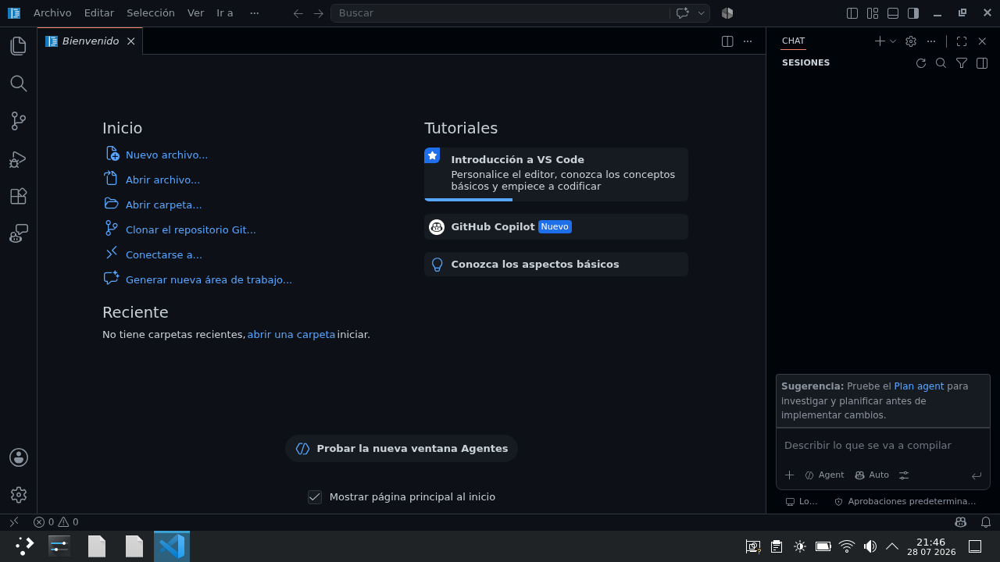
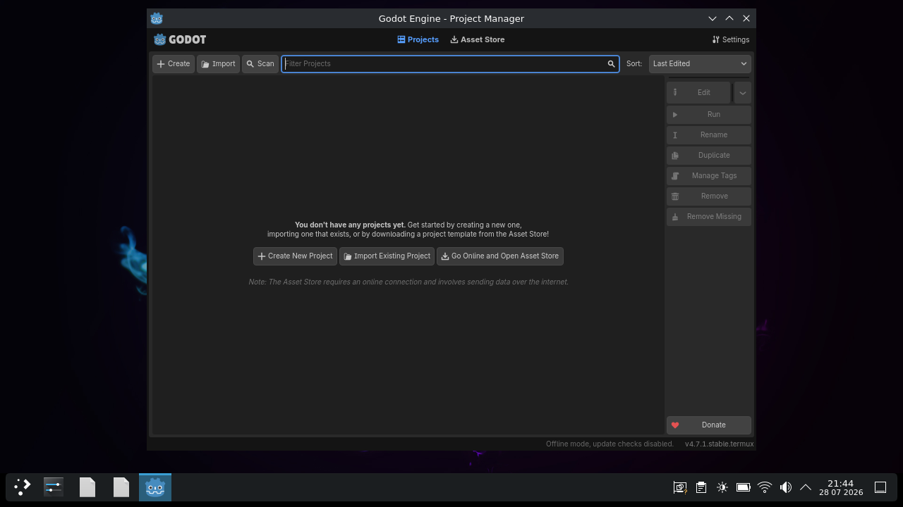
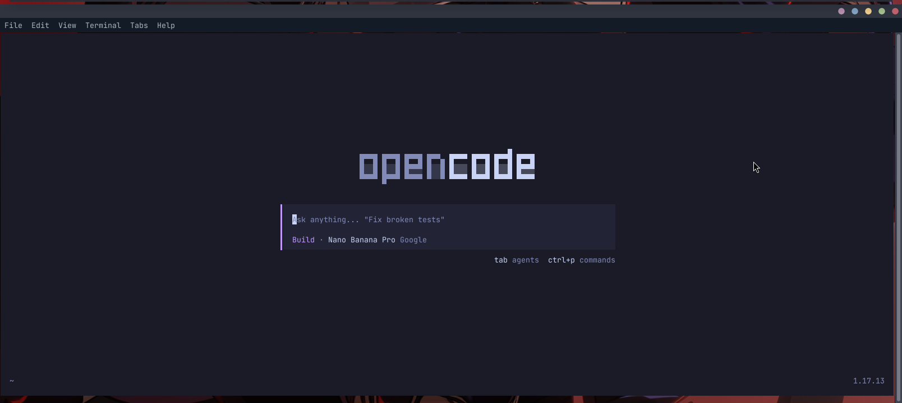
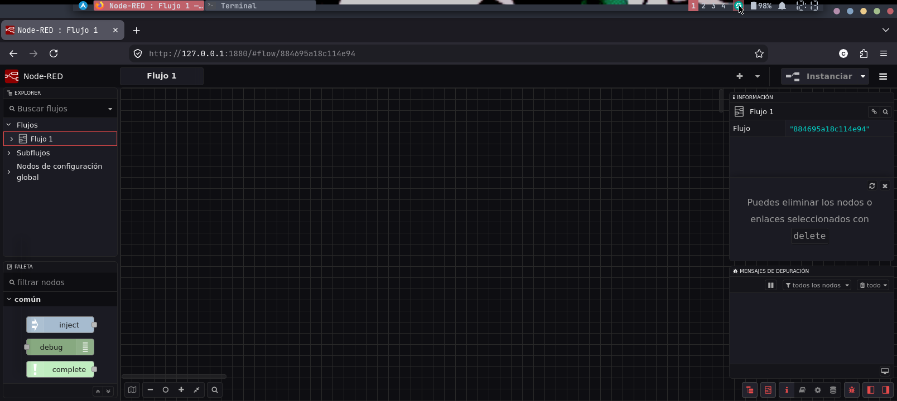
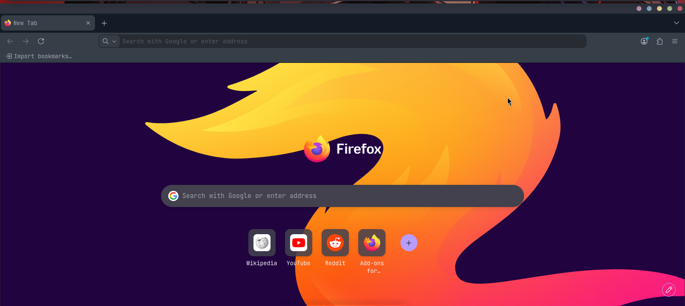

# 📱 Termux-Dev-Station：Android 终极原生开发工作站
**Systemic Flow 出品**


<div align="center">

🌐 **语言选择 / Available Languages:**

[🇺🇸 English](README.md) | [🇪🇸 Español](README_ES.md) | [🇨🇳 中文](README_ZH.md) | [🇧🇷 Português](README_PT.md)

</div>

欢迎！如果您曾想将 Android 设备（通过 Samsung DeX 模式、连接外接显示器，或直接在手机/平板上）打造成一个无需 Root、无需沉重模拟层、无需神秘黑盒脚本的真正工程与开发工作站，那么您来对地方了。

本指南打破了必须安装整个 Linux 操作系统（PRoot/Chroot）才能在手机上进行真正编程的迷思。在这里，我们将**原生性能、轻量级编辑器与直接硬件图形加速**结合，构建出 100% 稳定的开发环境。

本指南融合了两个维度的优势：**通俗易懂、循序渐进的步骤解析**让您透彻理解系统底层发生的变化；同时提供**精准严谨的技术指令与自动化运维脚本**，彻底释放硬件潜能。

---

## 💡 项目设计哲学与透明度

我们经历过陈旧过时的网络教程、卡顿低效的模拟器，以及动辄安装臃肿 Linux 镜像却导致系统内存与电池迅速耗尽的黑盒自动化脚本。本项目截然不同：**基于 Termux 100% 原生构建**，绝无盲目黑盒操作。

这里没有中间虚拟化损耗，完全依托 Termux 原生生态榨取硬件性能：
* **Web 与服务端开发：** 完整的 Node.js 与 Python 运行环境，结合 Node-RED 可视化事件驱动流引擎。
* **Godot 4 原生游戏开发：** 在手机端独立完成游戏工程构建、调试并直接编译签名导出 Android Debug APK，无需依赖 PC。
* **Kiwix 与 Web 离线知识库：** 本地极速检索海量技术文档（DevDocs、MDN、ArchWiki、Godot Docs），零流量消耗。
* **端侧本地人工智能：** 通过 Ollama 在本地部署大语言模型，并由 **Shell-Agent** 实现终端交互式自动化。
* **混合渲染架构：** CPU 渲染高稳定性 XFCE 桌面，按需为大型 3D 应用提供独立 GPU 硬件加速。

---

## 🖼️ 环境界面预览

完成配置并应用 Systemic Flow 定制主题后，您的工作站界面呈现如下：

| 现代化 XFCE 桌面 | 核心代码编辑器 (Code OSS) |
| :---: | :---: |
|  |  |

| Godot 4 游戏引擎 (Android 导出) | 终端 AI 助手 (Shell-Agent) |
| :---: | :---: |
|  |  |

| 自动化流控制 (Node-RED) | 硬件加速浏览器 (Firefox) |
| :---: | :---: |
|  |  |

---

## 📍 目录索引

1. [⚡ 混合图形加速架构 (VirGL + Vulkan + ANGLE)](#-混合图形加速架构-virgl--vulkan--angle)
2. [📋 桌面环境与显示服务器选择](#-桌面环境与显示服务器选择)
3. [🚀 准备工作：配置 Termux](#-准备工作配置-termux)
4. [🛠️ 分步安装指南（手动配置）](#️-分步安装指南手动配置)
   * [第 1 阶段：基础系统准备](#第-1-阶段基础系统准备)
   * [第 2 阶段：软件源、系统工具与 VirGL 图形加速层 (Mali GPU)](#第-2-阶段软件源系统工具与-virgl-图形加速层-mali-gpu)
   * [第 3 阶段：人工智能助手 (Shell-Agent + Ollama)](#第-3-阶段人工智能助手-shell-agent--ollama)
   * [第 4 阶段：部署 Node-RED 与智能磁盘空间清理](#第-4-阶段部署-node-red-与智能磁盘空间清理)
   * [第 5 阶段：安装 XFCE 桌面、显示服务器与开发套件](#第-5-阶段安装-xfce-桌面显示服务器与开发套件)
   * [第 6 阶段：解决幽灵进程查杀问题 (Android 12+)](#第-6-阶段解决幽灵进程查杀问题-android-12)
   * [第 7 阶段：VNC 启动配置 (`xstartup`)](#第-7-阶段vnc-启动配置-xstartup)
   * [第 8 阶段：视觉定制、动画与美化 (Systemic Flow)](#第-8-阶段视觉定制动画与美化-systemic-flow)
   * [第 9 阶段：在启动项中启用按需 GPU 加速（可选）](#第-9-阶段在启动项中启用按需-gpu-加速可选)
   * [第 10 阶段：Godot 4 套件 + 原生 Android SDK 目录结构](#第-10-阶段godot-4-套件--原生-android-sdk-目录结构)
   * [第 11 阶段：离线文档中心 (Kiwix 与 Web 文档)](#第-11-阶段离线文档中心-kiwix-与-web-文档)
5. [🕹️ 系统自动化脚本](#️-系统自动化脚本)
6. [📜 开源许可证](#-开源许可证)
   
---
   
## ⚡ 混合图形加速架构 (VirGL + Vulkan + ANGLE)

不同于绝大多数局限于高通骁龙（Adreno/Turnip）平台的方案，本配置通过原生图形转换链路，在 **ARM Mali GPU**（联发科天玑/曦力、三星猎户座、紫光展锐）上成功实现了**真实 GPU 硬件加速**。

Systemic Flow 高性能表现的核心在于**按需加速架构**：
1. 基础桌面环境采用 CPU 软渲染（llvmpipe），保证 100% 运行稳定性，彻底根除桌面黑屏、花屏与崩溃闪退（`BadMatch` 错误）。
2. 仅在启动大型 3D 应用（如 Godot Engine、Firefox）时，针对该应用独立挂载 GPU 硬件渲染。

该机制在保障高帧率流畅运行的同时，能让设备在持续满载下保持极低温度（约 36 °C）。

---

## 📋 桌面环境与显示服务器选择

针对低功耗与内存敏感型设备（如 4 GB RAM）进行了深度优化：

### 1. 桌面环境：XFCE4
* **XFCE：** 极其轻量、极速且模块化。配合定制的任务栏与 Whisker 菜单，既具备现代桌面的高颜值，又仅占用极少的系统内存。

### 2. 显示服务器模式
* **原生 X11 (`termux-x11-nightly`)：** 通过专属 Android App 直接渲染至屏幕（`DISPLAY=:0`），具备超低输入延迟以及完善的触控与触控笔支持，为官方首选推荐模式。
* **VNC 服务器 (TigerVNC)：** 适用于无投屏线或无线大屏扩展场景，局域网连接 `127.0.0.1:5901` 即可远程工作。

*安装程序会同时配置两种模式，可自由切换。*

---

## 🚀 准备工作：配置 Termux

强烈建议直接从 GitHub 官方 Releases 下载适配设备架构的 **`arm64-v8a`** 安装包，避免使用通用臃肿打包版本，将系统初始基底控制在约 30 MB。

---

## 🛠️ 分步安装指南（手动配置）

### 第 1 阶段：基础系统准备
授予存储读取权限，配置镜像源（可选）并全量升级系统基础包：

```bash
termux-setup-storage
termux-change-repo  # (可选：按需选择更快的本地镜像)
apt list --upgradable
apt full-upgrade -y
```

### 第 2 阶段：软件源、系统工具与 VirGL 图形加速层 (Mali GPU)
添加核心社区源（`tur-repo`、`x11-repo`），安装进程管理工具（`procps` 包含 `killall` 与 `pkill`）、终端美化工具、Kiwix 工具链，并配置基于 ANGLE 和 Vulkan 的 Mali GPU 加速层：

```bash
pkg install tur-repo x11-repo android-tools -y
pkg install git unzip wget curl ripgrep procps figlet neofetch kiwix-tools -y
pkg install virglrenderer virglrenderer-android angle-android vulkan-loader-generic openssl -y

# 1. 移除可能冲突的软件光栅化驱动
pkg remove '*icd-swrast' 2>/dev/null

# 2. 安装 Mesa 的 Vulkan ICD 包装器
wget 'https://github.com/ar37-rs/virgl-angle/releases/download/latest/mesa-vulkan-icd-wrapper_25.0.0-1_aarch64.deb'
dpkg -i mesa-vulkan-icd-wrapper_25.0.0-1_aarch64.deb
rm mesa-vulkan-icd-wrapper_25.0.0-1_aarch64.deb

# 3. 安装 vgl 守护管理工具
wget 'https://github.com/ar37-rs/virgl-angle/raw/refs/heads/main/vgl'
chmod +x vgl && mv vgl $PREFIX/bin/
```

### 第 3 阶段：人工智能助手 (Shell-Agent + Ollama)
采用专为移动端优化的 **[shell-agent](https://github.com/adegard/shell-agent)**，借助 Ollama 在终端内直接运行大模型，配置完成后完全脱离网络运行：

1. **一键拉取与自动化部署：**
   脚本会自动拉取仓库、配置 Ollama 环境、根据设备当前 RAM 自动匹配下载推荐的编程模型，并将别名写入 `~/.bashrc`：
   ```bash
   git clone https://github.com/adegard/shell-agent.git
   bash shell-agent/setup-termux.sh
   source ~/.bashrc
   ```

2. **终端交互使用：**
   ```bash
   agent              # 进入交互式代码助手会话
   agent "你的提示词"  # 直接执行单条指令任务
   ```

3. **配置 `~/.bashrc` 环境变量：**
   确保启动脚本包含语言配置与 GPU 别名：
```bash
cat << 'EOF' >> ~/.bashrc
# 语言环境配置
export LANG=es_ES.UTF-8
export LANGUAGE=es_ES.UTF-8
export LC_ALL=C.UTF-8

# 3D 大型应用按需 GPU 硬件加速别名 (如：gpu godot)
alias gpu='env -u LIBGL_ALWAYS_SOFTWARE GALLIUM_DRIVER=virpipe MESA_GL_VERSION_OVERRIDE=4.1COMPAT MESA_GLSL_VERSION_OVERRIDE=410'

clear
echo 'Systemic Flow Dev Station' | figlet 2>/dev/null || echo 'Termux Dev Station'
neofetch 2>/dev/null || true
EOF
source ~/.bashrc
```

### 第 4 阶段：部署 Node-RED 与智能磁盘空间清理
部署轻量级流式自动化控制台（Node-RED），并执行深度缓存清理：

```bash
curl -o termux-nodered-native.sh 'https://raw.githubusercontent.com/Yerensoncasares/termux-dev-station/main/termux-nodered-native.sh'
chmod +x termux-nodered-native.sh
bash termux-nodered-native.sh

# 存储深度清理例程
npm cache clean --force && pip cache purge 2>/dev/null
pkg clean && apt autoremove --purge -y
rm -rf $PREFIX/tmp/*
```

### 第 5 阶段：安装 XFCE 桌面、显示服务器与开发套件
安装 XFCE4 桌面本体、显示服务器（`TigerVNC` 与原生的 `termux-x11-nightly`）、PulseAudio 音频服务以及原生开发套件：

```bash
# 轻量化 XFCE 桌面与必备图形套件
pkg install xfce4 xfce4-goodies thunar htop xfce4-places-plugin picom geany qgit audacity mtpaint -y 

# 图形服务器与系统调试组件
pkg install tigervnc termux-x11-nightly -y  # 高性能原生 X11 服务

# 音频服务
pkg install pulseaudio -y

# 原生桌面开发套件
pkg install python nodejs code-oss godot firefox -y
```

### 第 6 阶段：解决幽灵进程查杀问题 (Android 12+)
防止 Android 进程冻结机制在后台切换时误杀编译与服务进程，通过无线 ADB 执行：

```bash
adb pair 192.168.xxx.xxx:xxxxx
adb connect 192.168.xxx.xxx:xxxxx
adb shell "/system/bin/device_config set_sync_disabled_for_tests persistent"
adb shell "/system/bin/device_config put activity_manager max_phantom_processes 2147483647"
adb shell settings put global settings_enable_monitor_phantom_procs false
```

### 第 7 阶段：VNC 启动配置 (`xstartup`)
若选用 VNC 远程会话，编辑配置文件 `~/.vnc/xstartup`：

1. 预初始化生成目录结构：
   ```bash
   vncserver && vncserver -kill :1
   ```
2. 写入启动配置：
```bash
cat << 'EOF' > ~/.vnc/xstartup
#!/data/data/com.termux/files/usr/bin/sh

export localhost="no"

# 强制基础桌面使用 CPU 软渲染确保最高稳定性
export LIBGL_ALWAYS_SOFTWARE=1
export GALLIUM_DRIVER=llvmpipe
export DISPLAY=:1

xset s off &
xset -dpms &

# 本地化与运行路径变量
export LANG=es_ES.UTF-8
export LANGUAGE=es_ES.UTF-8
export LC_ALL=C.UTF-8
export TMPDIR=/data/data/com.termux/files/usr/tmp
export XDG_RUNTIME_DIR=${TMPDIR}

# 加载资源并启动 XFCE 会话
[ -r $HOME/.Xresources ] && xrdb $HOME/.Xresources
dbus-launch --exit-with-session startxfce4
EOF
chmod +x ~/.vnc/xstartup
```

---

### 第 8 阶段：视觉定制、动画与美化 (Systemic Flow)
为桌面注入现代美学、高清字体渲染、Picom 窗口淡入淡出动画以及全套应用图标：

#### 1. 基础主题与终端美化
```bash
# 1. 基础工具与主题包
pkg install arc-gtk-theme papirus-icon-theme starship lsd fontconfig-utils -y

# 2. 终端提示符配置 (Starship Tokyo Night 预设)
mkdir -p ~/.config
starship preset tokyo-night -o ~/.config/starship.toml
```

#### 2. 部署 Assets v1.0.2 资源包（主题、图标、配置文件与应用套件）
下载 Systemic Flow v1.0.2 官方发布包，自动展开全套配置（XFCE 任务栏、Picom、GTK 主题、应用图标与启动器），并清理临时文件：

```bash
# 1. 清理旧缓存并拉取 v1.0.2 完整资产包
rm -rf ~/.fonts ~/.themes ~/.icons ~/assets.zip.001 ~/assets
curl -L -o ~/assets.zip.001 "https://github.com/Yerensoncasares/termux-dev-station/releases/download/V1.0.2/assets.zip.001"

# 2. 解压至用户根目录 (自动生成 ~/assets/)
unzip -qo ~/assets.zip.001 -d ~/ && rm ~/assets.zip.001

# 3. 部署字体、主题与基础图标
cp -rf ~/assets/.icons ~/assets/.themes ~/assets/.fonts ~/
fc-cache -fv

# 4. 部署自定义应用高分辨率图标
mkdir -p ~/.local/share/icons
cp -rf ~/assets/icons/* ~/.local/share/icons/ 2>/dev/null || true

# 5. 复制系统桌面级配置 (xfce4, gtk-3.0, picom, autostart)
mkdir -p ~/.config
cp -rf ~/assets/config/* ~/.config/

# 6. 安装专属桌面启动项 (Blockbench, DevDocs, Kiwix, Python Docs 等)
mkdir -p ~/.local/share/applications
cp -rf ~/assets/applications/* ~/.local/share/applications/ 2>/dev/null || true
update-desktop-database ~/.local/share/applications/ 2>/dev/null || true

# 7. 将本地服务模块 (Python UI 与 Kiwix UI) 移动至家目录
cp -rf ~/assets/docs/mi_kiwix_ui ~/assets/docs/mi_ui_python ~/

# 8. 彻底移除临时解压目录
rm -rf ~/assets

# 9. 禁用 XFCE 自带合成器 (由 Picom 接管高级动画效果)
xfconf-query -c xfwm4 -p /general/use_compositing -s false 2>/dev/null || true

# 10. 环境变量持久化注入
grep -q 'starship init bash' ~/.bashrc || echo 'eval "$(starship init bash)"' >> ~/.bashrc
grep -q 'alias ls="lsd"' ~/.bashrc || echo 'alias ls="lsd"' >> ~/.bashrc
source ~/.bashrc
```

---

### 第 9 阶段：在启动项中启用按需 GPU 加速（可选）
基础桌面保持 CPU 软渲染运行，对于高功耗 3D 软件，可通过修改桌面启动快捷方式直接赋予硬件加速：

* **Code-OSS (VS Code)：** 保持 **软件渲染** (`LIBGL_ALWAYS_SOFTWARE=1`)，彻底规避 Electron 内核在虚拟化层下的画面撕裂。
* **Firefox 与 Godot Engine：** 注入 **按需 GPU 硬件加速** (`GALLIUM_DRIVER=virpipe`)，获得极速响应的 3D 视口。

在 XFCE Whisker 菜单中右键点击应用选择 **编辑应用程序**：

* **Code-OSS:** `env LIBGL_ALWAYS_SOFTWARE=1 /data/data/com.termux/files/usr/bin/code-oss %F`
* **Firefox:** `env -u LIBGL_ALWAYS_SOFTWARE GALLIUM_DRIVER=virpipe MESA_GL_VERSION_OVERRIDE=4.1COMPAT MESA_GLSL_VERSION_OVERRIDE=410 firefox %u`
* **Godot Engine:** `env -u LIBGL_ALWAYS_SOFTWARE GALLIUM_DRIVER=virpipe MESA_GL_VERSION_OVERRIDE=4.1COMPAT MESA_GLSL_VERSION_OVERRIDE=410 godot %u`

---

### 第 10 阶段：Godot 4 套件 + 原生 Android SDK 目录结构

在 Termux 中运行 Godot 导出 APK 时，无需下载 Google 官方庞大的 Android Studio SDK（其预编译工具链仅适配 x86_64 架构）。Godot 实际上仅需识别一套标准的 SDK 目录骨架与原生调试签名组件。

> **技术要点：** 在 Termux 中安装 `apksigner` 时，包管理器会自动解析并将 **Java 21 OpenJDK** (`openjdk-21`) 作为核心依赖一并安装，一步搞定全套编译链。

#### 1. 建立工具链与软链接
```bash
# 1. 安装 Android 工具集 (自动包含 Java 21)
pkg install android-tools apksigner -y

# 2. 构建 Godot 识别所需的目录树
mkdir -p ~/android-sdk/platform-tools
mkdir -p ~/android-sdk/build-tools/36.0.0

# 3. 将原生 adb 软链接至 platform-tools
ln -s $(which adb) ~/android-sdk/platform-tools/adb

# 4. 将原生 apksigner 软链接至 build-tools
ln -s $(which apksigner) ~/android-sdk/build-tools/36.0.0/apksigner
```

#### 2. 在 Godot 编辑器内指定路径
启动 Godot（`gpu godot`），前往 **编辑器 > 编辑器设置 > 导出 > Android**，填写绝对路径：

* **Java SDK Path:** `/data/data/com.termux/files/usr/lib/jvm/java-21-openjdk`
* **Android SDK Path:** `/data/data/com.termux/files/home/android-sdk`
* **Debug Keystore:** `/data/data/com.termux/files/home/.local/share/godot/keystores/debug.keystore`
* **Debug Keystore 用户名:** `androiddebugkey`
* **Debug Keystore 密码:** `android`

---

### 第 11 阶段：离线文档中心 (Kiwix 与 Web 文档)

为实现彻底摆脱互联网依赖，防止在公共网络中检索低质错误信息，本方案在 [GitHub Releases 发布页](https://github.com/Yerensoncasares/termux-dev-station/releases) 托管了两套高价值离线文档库：

1. **Kiwix 知识库 (`kiwix.zip.*`)：** 8 卷分卷压缩包，包含完整 **ArchWiki** 全文、Termux 官方手册、FreeCodeCamp 编程课程、Bootstrap 手册以及 LibreTexts 大学理工科教科书（高等数学与工程学）。
2. **Web 开发与电子书套件 (`python.zip.*`)：** 3 卷分卷压缩包，包含全量离线静态站点：**MDN Web Docs 圣经**、**Godot 官方完整文档**、交互式 **learn-gdscript** 编程教程以及 **librosgratis.dev** 精选技术书库。

---

#### 📥 1. 终端命令行直接下载（可选）
无需打开浏览器，直接在终端中拉取全部离线卷至系统下载目录：

```bash
cd ~/storage/downloads
BASE_URL="https://github.com/Yerensoncasares/termux-dev-station/releases/download/V1.0.2"

# 下载 Python / Web 文档分卷 (共 3 卷)
for p in 001 002 003; do
  wget -c --show-progress "$BASE_URL/python.zip.$p"
done

# 下载 Kiwix 知识库分卷 (共 8 卷)
for k in 001 002 003 004 005 006 007 008; do
  wget -c --show-progress "$BASE_URL/kiwix.zip.$k"
done
```

---

#### 📦 2. 分卷包合并与解压
下载完成后，利用 `cat` 命令流式合并并一键解压：

```bash
cd ~/storage/downloads

# 1. 合并并提取 Kiwix 知识库 (自动解压至 Downloads/kiwix/)
cat kiwix.zip.* > kiwix_temp.zip
unzip -qo kiwix_temp.zip -d ~/storage/downloads/
rm kiwix_temp.zip

# 2. 合并并提取 Web 文档套件 (自动解压至 Downloads/python/)
cat python.zip.* > python_temp.zip
unzip -qo python_temp.zip -d ~/storage/downloads/
rm python_temp.zip
```

> **注意：** 无需手动预先创建子目录，压缩包内部已包含 `kiwix/` 与 `python/` 顶层根目录。解压完成后可安全删除分卷文件 `.zip.001`、`.zip.002` 等以释放磁盘空间。

---

#### 🚀 3. 访问本地离线文档库
* **图形界面一键直达：** 在 XFCE Whisker 菜单中，直接点击定制图标（**Kiwix Docs Offline** 或 **Web & Godot Docs Offline**）。系统会自动在后台唤醒对应服务并调出 Firefox 打开指定端口。
* **命令行终端交互：** 
  * 访问 Kiwix：运行 `Kw`（服务运行于 `http://localhost:8080`）。
  * 访问 Web 文档中心：运行 `Py`（服务运行于 `http://localhost:8081`）。

---

## 🕹️ 系统自动化脚本

所有管理脚本均存放在 `$PREFIX/bin/` 目录下，可在任何终端界面直接调用。

### 1. 系统无忧更新脚本 (`up`)
```bash
cat << 'EOF' > $PREFIX/bin/up
#!/data/data/com.termux/files/usr/bin/bash
apt list --upgradable
yes | pkg update && pkg upgrade -y
EOF
chmod +x $PREFIX/bin/up
```

### 2. 原生 X11 图形会话启动脚本 (`on`)
```bash
cat << 'EOF' > $PREFIX/bin/on
#!/data/data/com.termux/files/usr/bin/bash

termux-wake-lock
am force-stop com.termux.x11 2>/dev/null
pkill -9 -f termux-x11 2>/dev/null
vgl q 2>/dev/null
pkill -9 -f virgl 2>/dev/null
pkill -9 -f picom 2>/dev/null
sleep 1

TMPDIR=/data/data/com.termux/files/usr/tmp
rm -rf "$TMPDIR"/.X11-unix/X* "$TMPDIR"/dbus-* "$TMPDIR"/pulse-* "$HOME"/.cache/sessions/*

# 启动基于 Vulkan 后端的 VirGL 服务
vgl angle=vulkan &
sleep 2

# 启动 Termux-X11 与 Android 视图容器
export DISPLAY=:0
termux-x11 :0 -ac &
sleep 2
am start --user 0 -n com.termux.x11/.MainActivity >/dev/null 2>&1

# 启动音频服务与环境配置
pulseaudio --start --exit-idle-time=-1 2>/dev/null
export LANG=es_ES.UTF-8
export LIBGL_ALWAYS_SOFTWARE=1
export GALLIUM_DRIVER=llvmpipe

[ -r $HOME/.Xresources ] && xrdb $HOME/.Xresources

# 纯净启动 XFCE 会话 (Picom 动画合成器由自启服务拉起)
dbus-run-session -- startxfce4
EOF
chmod +x $PREFIX/bin/on
```

### 3. VNC 远程会话启动脚本 (`vnc-on`)
```bash
cat << 'EOF' > $PREFIX/bin/vnc-on
#!/data/data/com.termux/files/usr/bin/bash

termux-wake-lock
export TMPDIR=/data/data/com.termux/files/usr/tmp
export DISPLAY=:1

# 1. 深度清理残留套接字
vncserver -kill :1 >/dev/null 2>&1
rm -rf "$TMPDIR"/.X11-unix/X1 "$TMPDIR"/dbus-* "$TMPDIR"/pulse-* "$HOME"/.vnc/*.pid "$HOME"/.vnc/*.log

# 2. 启动 Vulkan 图形后端
vgl q 2>/dev/null
pkill -9 -f virgl 2>/dev/null
vgl angle=vulkan &
sleep 2
sync

# 3. 音频初始化
pulseaudio --start --exit-idle-time=-1 2>/dev/null

# 4. 启动 VNC 监听服务
vncserver :1 -geometry 1280x720 -depth 24 -localhost no
echo -e "\n[✓] VNC 服务已就绪，请连接客户端至：127.0.0.1:5901"
renice -n -10 -p $(pgrep -f vncserver) 2>/dev/null
EOF
chmod +x $PREFIX/bin/vnc-on
```

### 4. Kiwix 离线文档管理脚本 (`Kw`)
```bash
cat << 'EOF' > $PREFIX/bin/Kw
#!/data/data/com.termux/files/usr/bin/bash

LIBRARY_DIR="$HOME/mi_kiwix_ui"
LIBRARY_XML="$LIBRARY_DIR/cursos_library.xml"
ZIM_PATH="$HOME/storage/downloads/kiwix"
PORT=8080

mkdir -p "$LIBRARY_DIR"

# 若 8080 端口已被占用则释放
fuser -k $PORT/tcp 2>/dev/null || pkill -f "kiwix-serve" 2>/dev/null

echo "[+] 正在扫描并索引 $ZIM_PATH 目录下的 .zim 知识包..."
if ls "$ZIM_PATH"/*.zim 1> /dev/null 2>&1; then
    for zim in "$ZIM_PATH"/*.zim; do
        kiwix-manage "$LIBRARY_XML" add "$zim"
    done
    echo "[✓] 知识包索引建立完毕。"
else
    echo "[!] $ZIM_PATH 目录下未检测到 .zim 格式文档。"
fi

echo "[+] 正在启动 Kiwix 守护服务至 http://127.0.0.1:$PORT..."
if [ -f "$LIBRARY_DIR/index.html" ]; then
    kiwix-serve --port=$PORT -c "$LIBRARY_DIR/index.html" --library "$LIBRARY_XML" --daemon
else
    kiwix-serve --port=$PORT --library "$LIBRARY_XML" --daemon
fi

echo "[✓] Kiwix 正在后台稳定运行，请在浏览器中访问 http://localhost:$PORT"
EOF
chmod +x $PREFIX/bin/Kw
```

### 5. Python 离线文档服务管理脚本 (`Py`)
```bash
cat << 'EOF' > $PREFIX/bin/Py
#!/data/data/com.termux/files/usr/bin/bash
if [ -f "$HOME/mi_ui_python/server.py" ]; then
    echo "[+] 正在启动 Python 本地 Web 文档服务..."
    python3 "$HOME/mi_ui_python/server.py"
else
    echo "[!] 启动失败：未找到文件 $HOME/mi_ui_python/server.py"
fi
EOF
chmod +x $PREFIX/bin/Py
```

### 6. 一键优雅关机脚本 (`off`)
```bash
cat << 'EOF' > $PREFIX/bin/off
#!/data/data/com.termux/files/usr/bin/bash

termux-wake-unlock
export TMPDIR=/data/data/com.termux/files/usr/tmp

echo "正在关闭开发工作站并安全释放资源..."

# 1. 彻底退出 XFCE 桌面会话与合成器
killall -9 xfce4-session startxfce4 xfwm4 xfdesktop xfce4-panel picom 2>/dev/null
pkill -9 -f picom 2>/dev/null

# 2. 终止所有图形服务器 (VNC、X11 与 Vulkan/VirGL)
vncserver -kill :1 >/dev/null 2>&1
pkill -9 Xvnc 2>/dev/null
am force-stop com.termux.x11 2>/dev/null
pkill -9 -f termux-x11 2>/dev/null
vgl q 2>/dev/null
pkill -9 -f virgl 2>/dev/null

# 3. 关闭后台守护服务与本地文档服务端
killall -9 dbus-daemon 2>/dev/null
pulseaudio --kill 2>/dev/null
pkill -9 -f "kiwix-serve" 2>/dev/null
pkill -9 -f "mi_ui_python/server.py" 2>/dev/null

# 4. 强制释放本地监听网络端口
fuser -k 8080/tcp 2>/dev/null
fuser -k 8081/tcp 2>/dev/null

# 5. 深度清理临时套接字缓存文件
rm -rf "$TMPDIR"/.X11-unix/X* "$TMPDIR"/dbus-* "$TMPDIR"/pulse-* 
rm -rf "$HOME"/.vnc/*.pid "$HOME"/.vnc/*.log "$HOME"/.cache/sessions/*

echo "[✓] 所有服务已安全退出，运行内存已彻底释放。"
EOF
chmod +x $PREFIX/bin/off
```

---

## 📜 开源许可证
本项目遵循 **MIT 许可证** 开源发布。由 **Systemic Flow** 倾力打造。
